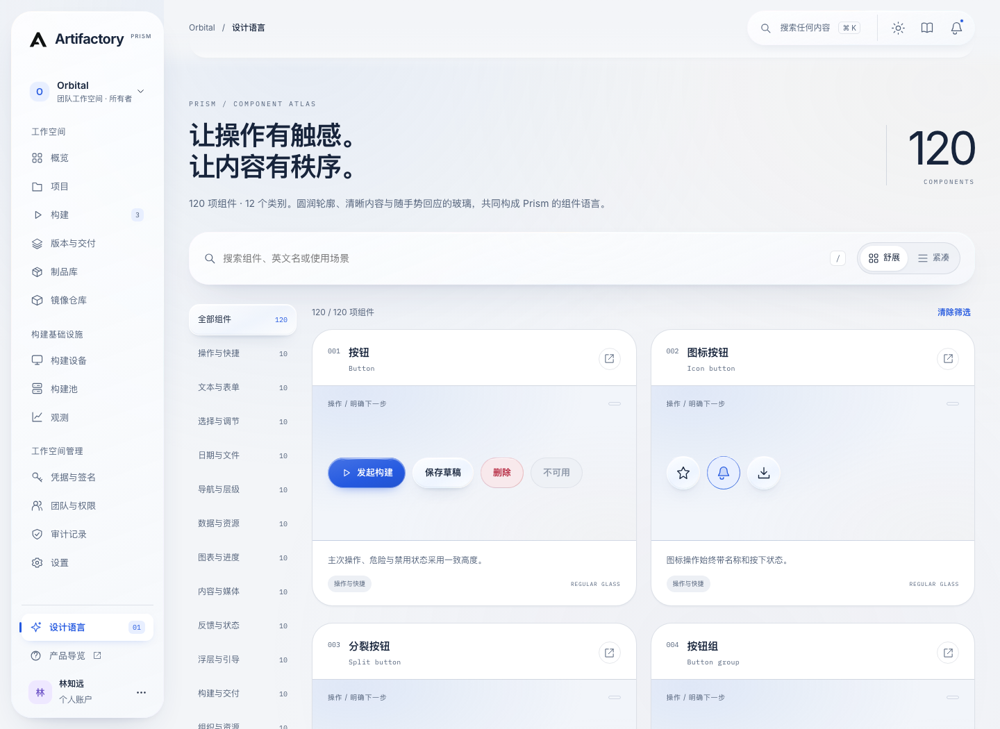
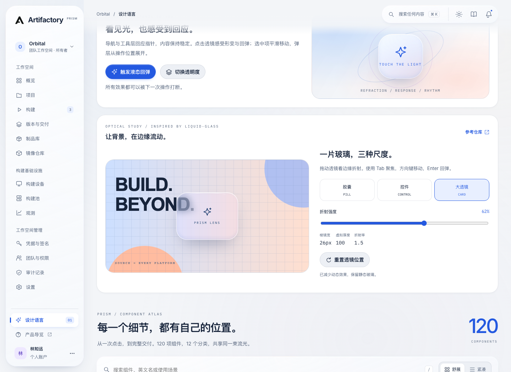
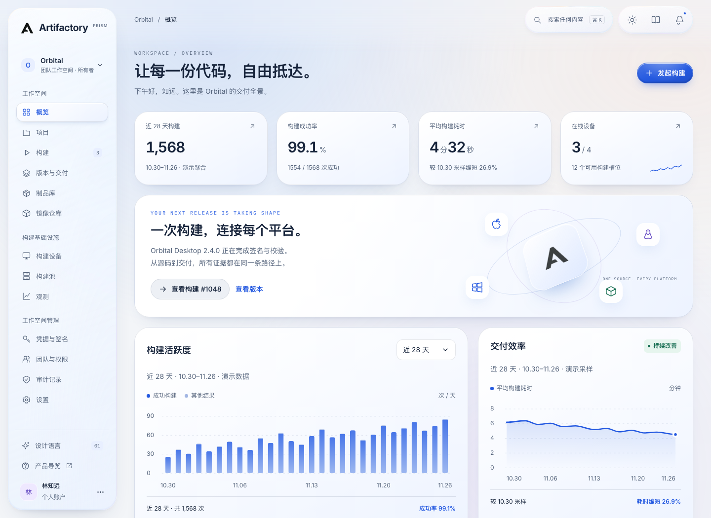
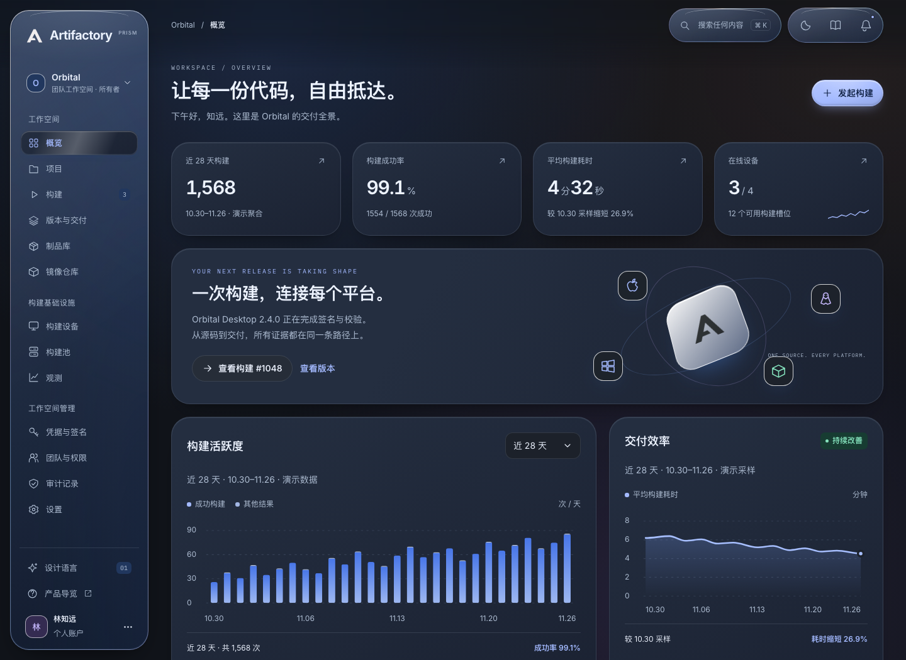
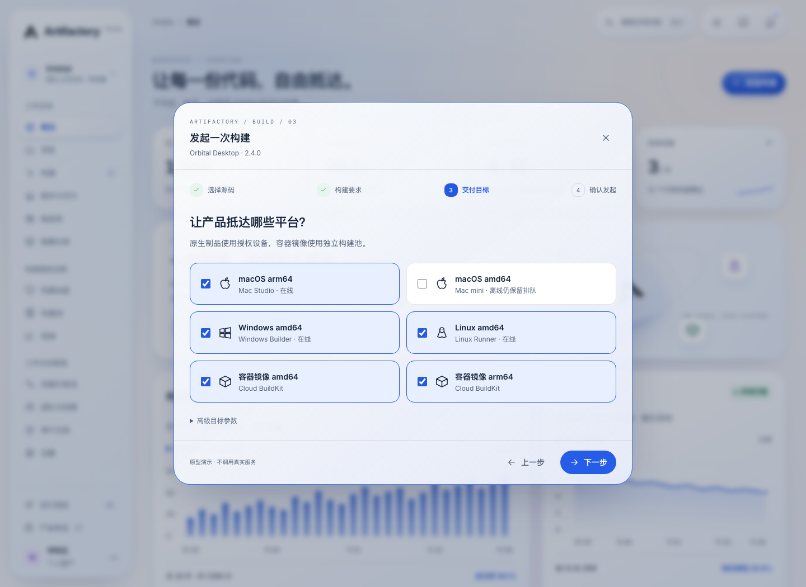

<!--
[INPUT]: Prism 主规范、组件规格、同步矩阵与本地交互原型。
[OUTPUT]: 提供评审入口、启动方式、场景清单和交付边界。
[POS]: 本次产品设计交付的总入口；现有控制台规范见 docs/design-system.md。
[PROTOCOL]: Update this header on change, then check AGENTS.md
-->
# Artifactory · Prism 流光工作台

**把源码变成可信交付。**

一套完整的液态玻璃设计语言，以及能够连续操作的产品原型。以 [Apple Liquid Glass 官方原则](APPLE-LIQUID-GLASS.md)为最高设计准则。包含浅色、深色、降低透明度、增强对比度、桌面和手机布局。

## 打开原型

在项目根目录执行：

```sh
python3 -m http.server 4173 --bind 127.0.0.1
```

浏览器打开：

```text
http://127.0.0.1:4173/design-system/artifactory/prototype/
```

原型使用浏览器 ES Modules，需要通过 HTTP 打开。无需安装依赖或启动后端。字体、品牌符号与页面资源全部位于本地。

从 `#login` 开始评审登录、工作空间和项目路径。界面统一称「工作空间」，底层对应租户隔离边界。完整范围为账户 → 工作空间 → 项目 → 版本 → 构建。

## 设计文件

| 文件 | 内容 |
| --- | --- |
| [APPLE-LIQUID-GLASS.md](APPLE-LIQUID-GLASS.md) | 最高设计准则、官方来源、材质层级与 Web 解释 |
| [MASTER.md](MASTER.md) | 品牌、材质、语义配色、明暗主题、字体、字号、排版、布局、动效、可访问性 |
| [COMPONENTS.md](COMPONENTS.md) | 38 个核心模式与 120 项组件总目录 |
| [COMPONENTS-INPUTS.md](COMPONENTS-INPUTS.md) | 40 项操作、表单、选择、日期与文件组件 |
| [COMPONENTS-DATA.md](COMPONENTS-DATA.md) | 40 项导航、数据、图形与内容组件 |
| [COMPONENTS-FEEDBACK.md](COMPONENTS-FEEDBACK.md) | 40 项反馈、浮层、交付与组织组件 |
| [COMPONENT-AUDIT.md](COMPONENT-AUDIT.md) | 120 项逐个审查、材质选择、具体改动与验证边界 |
| [PRODUCT.md](PRODUCT.md) | 角色、信息架构、核心旅程、42 屏设计范围与状态矩阵 |
| [SYNCHRONIZATION.md](SYNCHRONIZATION.md) | 真实页面与原型的双向同步矩阵、证据和待办 |
| [tokens.json](tokens.json) | 可迁移的机器可读设计变量 |
| [prototype/index.html](prototype/index.html) | 独立交互原型入口 |
| [REVIEW.md](REVIEW.md) | 实际验证范围、结果与演示行为说明 |
| [PRODUCT-REVIEW.md](PRODUCT-REVIEW.md) | 产品原型逐项复核、修正与验证边界 |
| [LIQUID-GLASS-REFERENCE.md](LIQUID-GLASS-REFERENCE.md) | 外部玻璃设计研究、来源与吸收边界 |
| [artifactory-prism.zip](artifactory-prism.zip) | 完整规范、原型源码、本地资源与截图 |

## 材质语言

- Liquid Glass 构成导航与重要操作的功能层。
- 卡片采用不透明珠光 Standard，表格、图表、日志保留稳定阅读底。
- 业务功能外壳默认 Regular，Clear 只用于媒体与光学实验。
- 同类工具共享材质，内外形状保持同心圆角。
- 顶部弧光、1px 色散、10px/210% 滤镜与 30px 大外圆角是项目参数。
- 细弱高光与深柔阴影不侵入正文，不宣称为 Apple 固定数值。
- 冷白光场、墨色正文、钴蓝主操作、克制的语义状态色。
- Inter、系统中文字体、IBM Plex Mono 均使用本地资源或系统回退。

## 组件展厅

打开 `#design/components`，浏览 120 项组件。目录按 12 类组织，支持中英文搜索、分类筛选、密度切换与单项深链。日期选择、文件列表、排序与批量选择、树结构、命令面板、浮层、权限矩阵和交付队列均有本地交互标本。

本轮逐项精修按钮、输入、选择、导航、数据、媒体、反馈与交付组件。每项标注实际材质，重要工具共用玻璃外壳，正文保持清晰。完整明暗对照见[组件审查](COMPONENT-AUDIT.md)。产品原型的后续复核见[产品审查](PRODUCT-REVIEW.md)。

`#design` 的光学实验吸收 [xiaojiaenen/liquid-glass](https://github.com/xiaojiaenen/liquid-glass) 的分层材质、方向亮边与分尺度厚度。该研究服从 Apple 官方原则。透镜支持拖动、方向键移动、折射强度和三档预设。折射仅作用于本地演示图层；业务正文保持原形。Chromium 使用 SVG 位移，其余浏览器提供毛玻璃降级。

## 交互动效

- 重要功能外壳响应指针反光，内容卡片保持稳定。
- 进入玻璃外壳时，斜向流光掠过一次，细色散随方向变化。
- 控件按压带380ms弹性回弹与局部光环。
- 导航、标签和顶部工具的悬停泡连续滑动，选中层保留独立状态。
- 主题立即更新，玻璃高光环从按钮中心扩散，快速切换跟随最新选择。
- 页面分组进入，图表描线与进度条在进入视口时绘入。
- 组件库图表统一圆角渐变：环形、容量弧、上下等圆角柱与保形折线。
- 环形小分段按真实角度绘制，收窄为圆端短胶囊；可切换小比重示例。
- 数据更新过渡 650ms；减少动态效果时立即显示最终值。
- 弹窗参考触发位置展开，抽屉从侧面进入。
- 向导切换过渡正文，返回保留答案。
- `#design` 增加可点击的液态玻璃实验区。

快速操作取消旧动画。减少动态效果时直接呈现最终状态。降低透明度时关闭折射、色散与背景滤镜。空闲时没有常驻装饰循环。

实际操作演示：[玻璃与交互动效](previews/immersive-motion.mp4)。

## 建议评审路径

1. **登录 → 工作空间大厅**：填写虚构用户名，检查密码显隐、注册切换与主题。注册须确认密码。提交后进入 `#tenants`。
2. **工作空间大厅 → Orbital**：搜索空间、阅读邀请链接说明；选择空间后直接进入 `#projects`。
3. **项目目录**：搜索名称或仓库，切换生命周期筛选、名称/最近构建排序及卡片/列表视图。
4. **Northstar Studio → 首个项目**：切换至空空间，创建演示项目，检查归属与字段校验；再返回 Orbital。
5. **Orbital Desktop → 概览 / 版本**：检查项目来源、最近构建与版本；项目设置单独进入。范围切换器只列当前空间项目。
6. **项目版本 → 2.4.0 → 发起构建**：完成源码、要求、目标、确认四步，核对工作空间、项目、版本与构建面包屑。
7. **构建详情 → 版本发布**：查看过程、执行、计划、AI 审计与制品；演示日志断线重试、审计异常和预算；选择完整成功 #1047，明确确认冻结交付，再演示正式镜像外仓分发。
8. **共享设备、成员、凭据、设置**：检查设备五标签、独立终端、邀请、角色、账户订阅与 Webhook。
9. **设计语言**：操作液态玻璃实验，切换明暗、降低透明度与减少动态效果；在 375px 检查同一路径。

顶部搜索或 `⌘ K / Ctrl K` 可直接跳转。浏览器后退、前进保留深链位置。

登录和工作空间大厅使用独立全屏布局。大厅共用文档、通知和账户工具，主题位于账户偏好；登录保留跟随系统、浅色、深色选择。表单与内容卡片保持稳定阅读底，玻璃用于工具和装饰雕塑。项目概览、版本目录与新建版本各有独立地址；「管理项目」进入唯一分组设置侧栏。构建属于版本，跨项目聚合保留为概念扩展深链。

## 页面与深链

在原型 URL 后添加以下 hash：

| 范围 | 路由 |
| --- | --- |
| 账户与工作空间大厅 | `#login`、`#register`、`#tenants`、`#join/demo`、`#join/expired`、`#onboarding` |
| 工作空间 | `#overview`、`#projects` |
| 项目 | `#project/orbital`、`#project/orbital/builds`、`#project/orbital/artifacts`、`#project/atlas`、`#project/beacon`、`#project/docs`、`#project-settings/orbital/resources` |
| 版本与构建 | `#project/orbital/releases`、`#project/orbital/releases/new`、`#release/2.4.0/orbital`、`#release/2.3.8/orbital`、`#build/1044`、`#build/1047` |
| 概念聚合与交付 | `#builds`、`#releases`、`#artifacts`、`#registry` |
| 资源 | `#nodes`、`#nodes/pool/apple`、`#node`、`#node/windows`、`#node/linux`、`#node/mini`、`#terminal/studio`、`#pools`、`#observability` |
| 信任与组织 | `#settings/credentials`、`#settings/members`、`#settings/audit`、`#settings/general` |
| 账户与规范 | `#notifications`、`#verify/demo`、`#email-verify/demo`、`#unsubscribe/demo`、`#design`、`#design/components` |
| 平台与边界 | `#system`、`#access`、任意不存在的深链（404） |

登录、注册和版本创建是独立页面。工作空间创建、项目创建、邀请、构建四步、发布、设备加入、镜像分发、访问令牌和个人设置使用任务弹层。设备详情采用列表底页上的侧面板，含概览、资源、工具链、元数据和运维五个标签，终端使用独立页面。工作空间设置含十个分区，项目设置含六个分区，账户含资料、安全、偏好和通知四个分区。页面缺失、空搜索、空空间、字段错误、取消构建、已发布和离线排队均有对应状态。

`#tenants` 的 Orbital 提供四个项目快照。Northstar Studio 初始没有项目，用于评审首次创建。工作空间范围外对象显示不可用状态；其他空间的设备和构建数据不会填入空空间。版本与构建深链依赖所属项目上下文，建议沿项目版本入口进入。

## 演示数据与状态

全部项目、人员、域名、图表和签名证据均为虚构演示。原型不调用实际 API，不执行命令，不发送邮件，不触发真实构建或发布。安装包下载提供 `.demo.txt` 说明文件；清单和日志下载为浏览器生成的示例内容。

工作空间、项目、项目关注、目录视图、发布、邀请、通知、非敏感设置与构建选择快照保存在当前浏览器会话。密码不进入状态或存储。账户未保存表单关闭或切换分区前需确认，返回后保留输入。主题、降低透明度与增强对比保存在本地偏好。个人账户弹层提供「重置」入口。认证表单不保存或发送填写内容；登录与注册仅演示进入工作空间大厅。注册使用用户名、密码和确认密码，并遵守当前产品的 UTF-8 字节限制。原型不提供未实现的 SSO、找回密码和记住登录开关。

新建工作空间只填写名称，随后进入其空项目目录。生产标识由服务端生成；原型生成本地演示标识，并按标识隔离同名空间。大厅展示名称、角色和入口，不推造项目总数、最近访问时间或待接受邀请数量。新建项目校验名称的 100 UTF-8 字节限制与 HTTP/HTTPS/SSH 仓库地址；标识本地生成。表单包含源码凭据、资源授权、模型与构建上下文。目录仅展示 Project 合同字段，不将版本或成功率写成项目属性。创建结果只加入当前空间的本地演示目录，不验证真实仓库连通性，也不写入服务端。

`PRODUCT.md` 是完整产品蓝图。原型聚焦可评审的主要旅程。概览按 DashboardData 提供固定完整窗口；近期活动只作列表，不参与指标计算。主构建提供过程、执行、计划、AI 审计和制品五标签；历史缺失证据保留空态。真实控制台已有权限、遥测、分片日志和执行调度；原型与实现的具体差异以 [同步矩阵](SYNCHRONIZATION.md) 为准。组件展厅的 120 项标本不代表已有 120 项生产组件。

## 任务交互与边界

通知页面与抽屉共用同一事件和阅读修订。账户邮箱独立于用户名；验证后逐类开启邮件。验证与退订需要明确确认。工作空间和项目 Webhook 独立配置，原型不发送请求。访问令牌和 Webhook 只展示无访问能力的一次示例文本。

工作框架共用236px侧栏、16px外距、64px顶栏与24px内容留白。整层顶栏承载Regular光学，内部工具不重复模糊；展厅标本保留自身尺寸。

通知页使用账户级外壳，不挂工作空间侧栏。通知对象按所属工作空间切换，失权后移除链接。命令面板只列当前范围的导航、设置与项目，不列其他空间的固定对象。设置分区保留独立hash与历史，正文不再重复侧栏。新建版本只收SemVer和说明，输入后刷新恢复；取消、链接和后退需明确继续或放弃。

终端使用 `#terminal/studio`。每次授权在 5 秒后截止，演示租约为 45 秒；离开页面或明确结束会话后回收。粘贴先确认，只填入输入框，仍需点击发送。签名、Git、镜像 Secret 使用固定无访问能力材料，支持失败检查、公开元数据保存与停用，不收集真实材料。生命周期展示影响快照、删除标识与密码确认、等待取消和失败同一操作重试；密码不保存。

邮件页面提供有效、过期、已使用、读取失败、重试和登录返回样例。通知提供项目筛选、本地游标、内容修订重新未读和权限失效后移除正文。Webhook 提供本地测试投递、明确成功或失败、同一投递重试和分页。设备有限操作与固定版本升级均按请求阶段推进。剩余差异以同步矩阵为准。

## 预览

入口原型：[登录](previews/entry-review/login-light-1440.png) · [工作空间](previews/entry-review/workspaces-light-1440.png) · [项目目录](previews/entry-review/projects-dark-1440.png) · [手机项目](previews/entry-review/project-light-375.png)。

最新结果见[最终验收](previews/synchronization-review/FINAL-VALIDATION.md)。原型192组页面、48项材质与辅助偏好、137项项目交付范围检查通过。账户、设备和交付专项结果见[同步复验](previews/synchronization-review/AGENTS.md)。实际控制台完整套件的六项发现已修正并复验，类型检查与生产构建通过。真实服务与硬件不在本轮夹具验收范围。

明暗与手机完整预览见 [entry-review](previews/entry-review/AGENTS.md)。











组件库图表预览：[浅色](previews/charts-light.png) · [深色](previews/charts-dark.png) · [375px 手机](previews/charts-mobile.png)。

组件库图表精修保留独立范围。本轮产品复核修正了图表数据映射、采样与手机尺度。详见 [PRODUCT-REVIEW.md](PRODUCT-REVIEW.md)。

新建构建进入 `#build/1049`，展示本次选择的本地快照。原型不伪造源码解析或执行结果。非Studio设备与部分历史记录明确呈现缺失证据。产品预览见 [previews/product-review](previews/product-review/AGENTS.md)。
