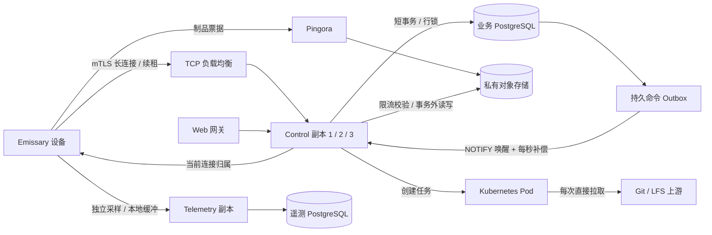

<!--
[INPUT]: PostgreSQL 复制协调、设备租约与无状态 Control。
[OUTPUT]: 定义当前多副本拓扑、连接预算和容量验收。
[POS]: Control 可用性与数据库容量入口。
[PROTOCOL]: Update this header on change, then check AGENTS.md
-->
# Control 多副本与设备容量

历史 Toasty 验收在三个实际 Control 进程上通过 10,000 条 mTLS 设备连接、1,000 个活动执行租约的故障压测，采用 PostgreSQL Outbox、NOTIFY 和定时补偿，无新增消息中间件。HA 配置每进程 40 条数据库连接；心跳 P99 682.09 ms、API P95 201.46 ms，全部 6,667 次重连在 20 秒预算内完成，期间有 215 次可恢复 RPC 重试。测试使用虚拟执行器，真实构建吞吐与生产容量仍需独立验收；详见 [Toasty 整合验收](acceptance/control-ha/2026-11-14-toasty.md)。

## 数据流与故障语义



调度按到期的 queued job 查询匹配节点，每轮最多 64 个任务。节点锁与锁后的新快照检查约束 slots，任务和命令在同一事务提交。调度不遍历所有空闲连接，不重复更新历史终态 Build。暂时没有匹配节点的任务延后 5 秒，防止不兼容平台堵塞后面的队列。

设备平台索引仅包含池、OS 和架构，不包含每次心跳都变化的 `last_seen`；节点表使用 80% fillfactor，为 PostgreSQL HOT 更新预留页内空间，减少心跳产生的索引和 WAL 写入。在线与证书时效仍在调度时按当前时间检查。

每个 Control 启动生成独立 UUID，节点保存当前 session 和连接归属。新会话的数据库初始化并发不超过每副本连接池的一半，最多 16 个，默认 20 条连接时为 10 个，HA 示例 40 条连接时为 16 个；覆盖证书匹配、替换 session 和首个 hello。登记使用一次有条件 UPDATE，同时核对 hello 的节点 ID、实际 mTLS 证书摘要、撤销和有效期，并写入 session、归属及首个健康快照，减少重连的数据库往返。其他请求先等待准入，不让重连突发耗尽已有设备续租的连接池。命令表只保存节点、attempt、类型等引用，不保存凭据或整个构建计划。发送时重建 assignment；只有连接归属匹配的副本才能投递。assignment 只包含固定源码元数据和任务身份。Git/LFS 字节不经过 Control。队列满或连接中断会重放同一 command ID、attempt ID 和 lease token。socket 写成功不算执行确认；accept 将 attempt 置为 running 后停止 assign 重放，终态确认 cancel。7 天前已确认命令按每批 1,000 条回收。

普通心跳的 `last_seen`、能力、诊断和普通 OTA 健康状态是可覆盖快照，单条更新使用事务内的 `synchronous_commit=off`，减少逐台等待 WAL 同步。数据库崩溃可能丢失最近尚未刷盘的健康样本，设备会在后续心跳补齐。新 session/归属注册、执行租约、命令、取消及具体 OTA 升级状态继续使用数据库配置的提交策略；生产业务库应保留同步提交和 fsync。设置在当前语句的隐式事务结束时恢复，不影响连接池后续事务。语义见 [PostgreSQL 异步提交说明](https://www.postgresql.org/docs/17/wal-async-commit.html)。

空闲设备的普通心跳只执行这一次有条件更新，直接复用其授权结果发送健康确认，避免再读一次节点。过期、撤销或被替换的 session 更新不到行，连接随即关闭。携带活动执行或具体 OTA 状态时，后续各自的事务仍重新核验授权与租约。

LISTEN/NOTIFY 只负责加速唤醒。所有工作触发器通过非阻塞的事务 advisory lock 合并并发通知，避免 PostgreSQL 的全局通知锁将业务提交串行化。未取得锁的事务仍提交业务状态与命令；通知可能早于这些事务可见，数据库提交后的命令表和每秒补偿负责恢复，通知丢失不会丢任务。连接和工作通知只唤醒任务调度与命令投递；OTA 检查及全局维护在独立循环中按每秒固定节奏执行，跳过错过的周期，避免重连反复触发全库维护。维护使用跨副本 advisory lock，单个 Build 的维护锁等待不阻塞新任务调度。重复投递由现有 Emissary 状态机与 lease fencing 处理。正在运行的任务续租跨副本有效；运行后租约过期保留为 lost，需要显式重试，不自动重新执行。

SIGTERM 先令 `/readyz` 返回 503，停止新会话和本地调度，并以每批 64 条、跳过忙节点的短提交清除本进程的数据库连接归属，避免一个行锁阻塞整批设备；现有会话在传播窗口内仍可续租。等待 drainSeconds 后关闭流，设备带抖动重新连接。其他副本不会继续给已清除归属的旧连接派新任务。`/healthz` 保持进程存活检查，`/readyz` 还检查数据库可用性。

## 为什么暂时不引入 MQ

构建状态、租约、取消与排队已经在 PostgreSQL 中。Outbox 将命令和状态一起提交，避免另一个消息系统与业务库之间的双写一致性问题。当前不依赖 Redis、RabbitMQ、Kafka 或 NATS。

当实测显示命令分发吞吐持续超出数据库预算，或需要跨区域、独立设备接入层、多个独立消费者时，再将 Outbox 发布到 NATS JetStream / RabbitMQ 等系统。届时仍需保持 Outbox、执行幂等和租约校验，不能用消息 ACK 代替执行状态。高频指标继续走独立 Telemetry，不进入控制命令队列。

## 存储和连接预算

制品 S3 GET、完整摘要校验与最终 PUT 均在业务事务之外。每副本有独立校验 semaphore，校验结束后以短事务重新检查节点、租约、取消状态及不可变声明，再写入唯一 artifact。并发相同声明只生成一条记录；校验期间过期或被取消的执行不能提交产物。

日志复用一条独立于控制长流的 mTLS channel，失败后由本地 spool 重试；不再每批新建 TLS 连接。设备重连、遥测失败重试和采样初始相位都有抖动。普通 OTA 健康上报只锁节点，只有具体升级任务上报参与池级序列化。

| 设置 | 默认 | 范围 / 用途 |
| --- | --- | --- |
| `ARTIFACTORY_DB_MAX_CONNECTIONS` | 20 | 每个 Control 进程 8–256；包含一条独立 LISTEN 连接 |
| `ARTIFACTORY_ARTIFACT_VERIFY_CONCURRENCY` | 4 | 每副本 1–32 |
| `ARTIFACTORY_SCHEDULER_BATCH_SIZE` | 64 | 每轮 1–256 |
| `ARTIFACTORY_CONTROL_DRAIN_SECONDS` | 5 | 1–30 秒 |
| `ARTIFACTORY_EMISSARY_RELEASE_SOURCE` | 数据目录下的文件 | 所有副本读取相同的 OTA 仓库及可信公钥配置 |
| `ARTIFACTORY_TELEMETRY_WRITE_CONNECTIONS` | 12 | 每遥测副本 2–128 |
| `ARTIFACTORY_TELEMETRY_READ_CONNECTIONS` | 4 | 每遥测副本 2–128，可配置只读数据库地址 |
| `ARTIFACTORY_TELEMETRY_AUTH_CONNECTIONS` | 4 | 每遥测副本读取业务授权库的连接数，2–128 |

连接预算按同一 PostgreSQL 实例合计。示例滚动更新最多 4 个 Control、2 个 Telemetry：业务连接为 `4×40+2×4=168`，遥测连接为 `2×(12+4)=32`，另加 Runtime 和运维连接。终止中的 Pod 也占用连接。`values-ha.yaml` 提供 Control 40 条连接与数据库 450 条连接的示例；应以实际池等待、工作集与续租延迟调整。

生产使用外部 HA PostgreSQL，将遥测放到独立实例以隔离 WAL 与 I/O。`DATABASE_URL` 应直连 PostgreSQL 或使用支持会话语义的 session pooling。LISTEN 不支持 transaction pooling。

Control 的 `temporaryStorage` 默认 10Gi，实际应大于“校验并发 × 最大制品大小”并预留余量；同一个制品的重复完成请求也会占用校验预算。临时盘不足会令校验失败，不能将 emptyDir 当作持久制品库。最终制品和日志由共享对象存储保存。

## Helm 部署

Control 每个副本使用独立 emptyDir，数据库和对象存储保存共享业务状态。源码由临时任务直接拉取，不依赖 Control PVC 或独立 Source。主 Chart 默认一个 Control，合并 `values-ha.yaml` 后部署三个副本。Deployment 使用 RollingUpdate、PDB 和反亲和性。

新安装初始化当前数据库基线。原型切换采用业务数据库重置，不提供旧数据库迁移或旧二进制回退。主密钥、设备 PKI、Registry 身份和允许保留的制品按运维方案保留。

外部 HA 存储设置 `postgres.enabled=false`、`s3.enabled=false`，凭据 Secret 指向目标服务，并填写私有 `s3.endpoint`。外部 HTTP 必须显式设置 `s3.allowHttp=true`。

Control 副本只解决 Control 进程故障。完整平台 HA 还取决于 Web、Runtime、数据库、对象存储与入口的故障域。

## 查询契约

`GET /api/v1/nodes` 保持 JSON 数组响应，默认最多 100 条；支持 `limit=1..500`、`offset=0..10000000`、最长 100 字节的 `q`。搜索匹配设备名、OS、池名，排序为 created_at 与 ID 倒序。Web 已使用服务端分页和搜索；总注册数由 overview 的 `nodes_registered` 提供。客户端按 `limit` 和 `offset` 分页。offset 翻页在并发注册时可能移动，严格库存导出应在固定快照下读取。

规划上下文将同池、平台、标签、能力、签名授权与工具版本的设备聚合，最多 128 类、序列化后最多 128 KiB，保留 count、online_count、tools、total_groups 和 truncated。单类详情超过 8 KiB 时保留平台与数量，省略标签、能力、签名授权和工具详情并标记 `details_omitted=true`。超过总预算时保留排在前面的类别，并显式标记截断。模型可识别信息缺失，不能据此假定未出现的平台或工具不存在。

## 回归与压测

`tests/control/load.py` 使用独立测试库中的随机 schema，启动三个真实 Control 子进程、独立目录和 mTLS 设备连接。默认每个 Control 使用 20 条数据库连接；HA 预算可通过 `--database-connections 40` 复现。测试数据库连接上限需覆盖三个连接池与测试端连接，例如 HA 档使用 200。默认 1,000 在线 / 100 活动，可用 `--nodes 5000 --active 500`、`--nodes 10000 --active 1000` 升档。测试先等待指定活动执行数，再按 10 秒周期心跳，强杀一个进程、对另一个发送 SIGTERM，验证连接恢复、attempt ID 不变、无 lease 取消。每档采集 API P95、心跳 P99、正常/强杀/排空三个阶段的延迟、连接恢复延迟、样本数、连接重试、数据库连接与锁等待峰值，以及最终幸存进程的 RSS / CPU 快照。

```sh
export ARTIFACTORY_TEST_DATABASE_URL='<disposable TimescaleDB URL>'
python3 tests/control/load.py --release --nodes 1000 --active 100 --seconds 60
python3 tests/control/load.py --release --nodes 10000 --active 1000 --seconds 60 \
  --database-connections 40
```

若 macOS 上 Rust 1.95 的 release 过程宏出现 `mis-aligned LINKEDIT string pool`，可加 `--cargo-config 'profile.release.build-override.strip="none"'`，只关闭构建工具/过程宏的符号剥离，保留目标程序的 release 优化。证据会记录该覆盖。

证据保存在 `.local/control-load/<timestamp>-<nodes>-<active>/evidence.json`，另有运行日志和经过 URL 过滤的 Control 日志。临时 schema 与进程在成功后清理；失败日志用于定位测试端与服务端问题。压测使用虚拟执行器和受控 S3 peer，覆盖控制连接与执行租约，不包括真实编译、制品吞吐、SSE 浏览人数或遥测采集吞吐；CPU 是单次快照，RSS 不是峰值。debug 构建、本机网络与共享开发机结果不构成生产 SLO。

数据库回归另覆盖事务回滚不发命令、队列满后重放、running/终态确认、跨构建 slots 竞争、取消和 OTA 排空、不兼容队列前缀、公钥/会话隐藏、分页及万台设备能力摘要。真实 mTLS 回归覆盖副本切换和 21 个等待慢 S3 的完成请求（20 个声明、1 个重复请求）：验证校验并发为 4，续租和 readiness 持续成功，最终只有 20 条 artifact；另验证校验等待期间被取消的请求不能提交制品。源码回归验证 Control 不传输仓库字节，任务每次直接访问固定上游，故障后重新检出相同清单。

Emissary 回归运行真实进程并注入一次日志 RPC 失败，断言所有日志从 spool 恢复且不重复，多个上传批次只使用控制流与日志各一条 TLS 连接。

## 运维观察与故障处置

重点观察最老未确认命令年龄、queued job 等待、租约续约分位数、重连率、数据库池等待、锁等待/WAL、校验队列和临时盘、遥测积压。重连期间的已开始任务应保留原 attempt；数据库中断超过租约窗口仍可能产生 lost，不能以恢复连接代替执行验收。

临时使用 `RUST_LOG=artifactory_control_plane=debug` 可记录新连接的 `admission_ms`、`identity_ms`、`session_ms` 和 `hello_ms`，分别定位准入等待、证书身份提取、有条件授权与会话写入、首个报告处理。压测可通过 `ARTIFACTORY_LOAD_LOG` 将过滤器传入测试子进程；默认保持 warn。

故障时先暂停新任务，保留可用副本并修复当前版本。原型数据库基线只支持新建，不运行旧版本二进制或旧数据库迁移。
