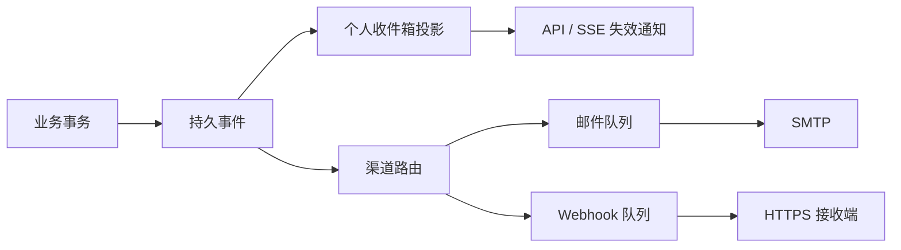

<!--
[INPUT]: 事务事件、顶栏收件箱、项目星标与外发实现。
[OUTPUT]: 定义通知入口、订阅、权限与运维契约。
[POS]: 通知基础设施使用和部署手册。
[PROTOCOL]: Update this header on change, then check AGENTS.md
-->
# 通知中心

通知中心是账户级基础设施。个人收件箱汇总当前有权访问的全部租户。
顶栏铃铛显示未读数量。账户入口在顶栏时，铃铛位于账户入口左侧。桌面打开 440px 抽屉，移动端打开全屏面板。
`/notifications` 提供分类、租户、项目、未读和待处理筛选。
通知详情展示同一事项的时间线，并跳转到业务页面。
即时操作反馈继续使用顶部居中的短暂通知。

## 接收规则

| 类别 | 接收对象与行为 |
| --- | --- |
| 构建、发布 | 构建发起人和显式关注该项目的成员。所有阶段按构建聚合；阶段推进更新正文，待确认和终态增加未读提醒。 |
| 成员与权限 | 受影响成员及当前范围管理员。撤权后只保留不含租户名、项目名和业务链接的个人提示。 |
| 设备 | 租户管理员接收离线、证书和升级失败。受影响构建的接收者只收到构建摘要。 |
| 凭据 | 租户管理员接收停用、删除和证书到期提醒。使用当前签名默认方案的项目管理员接收项目预警。 |
| 账户 | 本人接收改密与个人令牌变更。 |
| 工作区 | 操作发起人及当前管理员接收归档、删除等操作结果。删除成功后本人只保留最小结果。 |
| 渠道 | 本人或对应管理员在站内接收投递失败及恢复。此类别不再次外发。 |

站内通知默认开启。项目关注默认关闭。
项目概览名称旁的五角星控制项目通知订阅。
空心表示未关注，实心表示已关注。
首次读取和保存期间禁用星标。读取失败提供重试，保存失败保留原状态。
成员通知明确显示加入、角色变更或访问权限撤销。
角色只使用工作区和项目的固定角色文案。
资源授权通知明确提示检查项目可用资源。
撤权摘要不包含工作区名、项目名、成员身份和业务链接。
邮件类别订阅、Webhook 端点和事件订阅均默认关闭，必须显式启用。
首次启用或重新绑定渠道仅接收之后发生的事件，不补发历史消息。
关闭订阅不会改变业务事件，也不会删除现有时间线。
取消关注后，已有事项继续按当前权限静默更新，不增加未读或外发。
时间线保留首次接收后的变化，不展示关注前的历史。

设备超过 120 秒未上报才进入离线周期，连续两次健康扫描后恢复。
首次未连接、排空、升级排空、撤销和非活动租户不产生离线告警。
签名证书在 7 天、1 天和过期时各提醒一次；替换或停用后关闭旧版本提醒。

## 数据流与可靠性

业务表触发器在同一事务写入事件。事务回滚同时撤销事件。
触发器只写白名单字段，不读取或保存原始错误、日志、密文和密钥。
事件目录固定类型和 schema 版本；未知版本隔离，不阻塞其他事件。
投影通过聚合版本和唯一键去重。多个 Control 副本共享数据库租约。
邮件验证、业务邮件、Webhook 和收件箱分别运行，慢出口不阻塞其他渠道。
网络请求在数据库事务之外执行。
SMTP 完整尝试的总预算为 20 秒，涵盖 DNS、TLS 和响应等待。
超时释放当前租约并进入有界重试。

收件箱分别保存内容版本、提醒版本和已读版本。
标记已读携带页面所见提醒版本；全部已读携带已提交账户水位。
旧页面不能清除并发到达的新提醒。
SSE 只发送失效信号，客户端重新读取授权后的正文和计数。
会话失效后 SSE 结束；断线后客户端仍可刷新并重连。

候选接收者在事件发生时冻结，读取列表、计数、详情和外发前均复核当前权限。
邮件发送前还复核邮箱验证状态、绑定代数和当前订阅。
Webhook 发送前复核创建者当前管理员身份、端点范围和绑定代数。
改地址、轮换密钥或撤权会取消旧任务。已经开始的网络尝试无法撤回，晚结果不能恢复已取消任务。
资源删除在同一事务清除业务通知正文与待发任务。

外发提供至少一次投递，远端必须去重。
自动重试最多 10 次，且不超过创建后 24 小时；退避上限 1 小时。
Webhook 网络错误、429 和 5xx 重试，其余非 2xx 失败。
端点连续失败 5 次后暂停 1 小时。
邮件保持固定 Message-ID；Webhook 重试保持固定投递 ID 和事件 ID。
较新的终态或恢复事件会取消排队中的过时待确认、离线和凭据告警。
普通邮件只发送重要变化与恢复，不逐条发送构建阶段。

非待处理收件箱和无引用事件保留 90 天，待处理事项保留。
投递记录保留 90 天，诊断正文和错误字段在 30 天后清除。
清扫分批执行并跳过锁定行，避免覆盖并发更新。

## 邮件配置

个人设置中的「通知」提供类别偏好、语言和通知邮箱。
通知邮箱独立于登录用户名，不改变注册和改密流程。
验证链接有效 30 分钟，需登录原账户并显式确认。
数据库只保存验证令牌摘要；验证令牌只在 SMTP 尝试期间存在内存中。
同一任务重试保持验证令牌和 Message-ID，不延长原始 30 分钟期限。
重新绑定会撤销原验证和全部邮件订阅。
请求间隔至少 60 秒，每小时最多 5 次。
业务邮件提供退订链接和 RFC 8058 一键退订头。
SMTP 暂不可用时，修改站内偏好或语言保留原有邮件订阅。

| 环境变量 | 默认值与用途 |
| --- | --- |
| `ARTIFACTORY_SMTP_HOST` | 空；未配置时邮箱绑定不可用，站内和 Webhook 正常工作。 |
| `ARTIFACTORY_SMTP_FROM` | 配置 SMTP 时必填的发件地址。 |
| `ARTIFACTORY_SMTP_PORT` | 隐式 TLS 为 `465`；STARTTLS 为 `587`。 |
| `ARTIFACTORY_SMTP_STARTTLS` | `false` 使用隐式 TLS；`true` 使用必需的 STARTTLS。 |
| `ARTIFACTORY_SMTP_USERNAME` | 可选；与密码同时提供。 |
| `ARTIFACTORY_SMTP_PASSWORD` | 可选；通过 Secret 注入。 |

Helm 使用 `notifications.smtpSecretName` 引用包含上述键的现有 Secret。
不要把 SMTP 凭据写进 values 或仓库。
Compose 从运行环境读取相同变量。
`ARTIFACTORY_PUBLIC_URL` 必须是用户可访问的正式地址，用于验证、退订和业务链接。

## Webhook 配置与验签

租户设置和项目设置的「集成」分区提供 Webhook 配置。
只有对应管理员会话可创建、测试、查询诊断和重试；API Token 不具备此权限。
端点创建与轮换时只返回一次密钥，保存时使用平台主密钥加密。
诊断只展示 URL 的来源和安全错误代码，不回显路径、查询参数或响应正文。

端点必须使用 HTTPS，不接受 URL 凭据和片段，不跟随重定向，也不使用环境代理。
每次请求重新解析 DNS，验证全部地址，并将本次连接固定到已验证地址。
默认禁止私网；`ARTIFACTORY_WEBHOOK_PRIVATE_ALLOWLIST` 可显式允许逗号分隔的私网 CIDR。
Helm 对应 `notifications.webhookPrivateAllowlist`。
回环、链路本地、云元数据、共享地址和转换地址始终禁止。
平台出口防火墙仍应限定允许访问的接收端。

请求正文使用 CloudEvents 1.0，类型为 `application/cloudevents+json`。
包含事件 `id`、`type`、`time`、`source`、`artifactoryschemaversion`、
`aggregatekey`、`aggregateversion` 与白名单 `data`。
可订阅 `build.status.changed`、`build.phase.changed`、
`release.publication.changed`、`permission.member.changed`、
`permission.resources.changed`、`device.status.changed`、
`device.update.changed`、`credential.status.changed`、
`account.security.changed` 和 `workspace.lifecycle.changed`。
个人账户事件没有租户范围，因此不会发送给租户 Webhook。

请求头：

| 请求头 | 内容 |
| --- | --- |
| `X-Artifactory-Delivery` | 固定的投递 UUID。 |
| `X-Artifactory-Timestamp` | 本次尝试的 Unix 秒数。 |
| `X-Artifactory-Signature` | `v1=` 加小写十六进制 HMAC-SHA256。 |

签名原文为 `timestamp + "." + delivery_id + "." + 原始请求体字节`。
密钥使用一次性显示字符串的 UTF-8 字节。
接收端应常量时间比较签名、校验时间窗口，并按投递 ID 去重。
事件到达顺序不保证，使用聚合版本忽略过时状态。

## HTTP 接口

以下路径均位于 `/api/v1`。
个人通知使用账户会话，不要求当前租户头；写请求沿用 CSRF 校验。
管理接口要求 `X-Artifactory-Tenant` 和对应权限。

| 接口 | 用途 |
| --- | --- |
| `GET /notifications` | 游标分页；支持 category、tenant_id、project_id、unread、needs_action、limit。 |
| `GET /notifications/summary` | 未读、待处理数量及账户水位。 |
| `GET /notifications/scopes` | 全部当前可见收件范围，用于筛选项。 |
| `GET /notifications/{id}` | 聚合详情与时间线；使用 cursor 继续读取。 |
| `POST /notifications/{id}/read` | `{attention_revision}`。 |
| `POST /notifications/read-all` | `{watermark,category?,tenant_id?,project_id?}`。 |
| `GET /notifications/events` | SSE 失效信号。 |
| `GET/PUT /projects/{id}/notification-subscription` | 查询或设置 `{following}`。 |
| `GET/PUT /notifications/preferences` | 站内、邮件类别及语言偏好。 |
| `PUT/DELETE /notifications/email` | 绑定 `{address}` 或停用邮箱。 |
| `POST /notifications/email/resend` | 请求新的验证邮件。 |
| `POST /notifications/email/verify` | 原账户确认 `{token}`。 |
| `POST /notifications/email/unsubscribe` | 使用邮件中的 `{token}` 退订邮件。 |
| `POST /notifications/email/one-click?token=…` | RFC 8058 退订入口。 |

Webhook 集合路径为 `/tenant/notification-webhooks` 或
`/projects/{id}/notification-webhooks`。
集合支持 GET 和 POST；`/{endpoint}` 支持 PATCH 和 DELETE。
`/{endpoint}/test` 与 `/rotate` 支持 POST，`/deliveries` 支持 GET，
`/deliveries/{delivery}/retry` 支持 POST。
诊断返回最近 30 天最多 100 条记录。

## 运维与扩展

租户管理员可读取 `/tenant/notification-health`，查看待投影、隔离、最旧事件年龄、
邮件队列、Webhook 队列、重试、失败及暂停端点数量。
`/tenant/notification-metrics` 提供相同范围的 Prometheus gauge，不包含用户和正文标签。
这两个接口要求管理员会话，不是匿名监控出口。
持续增长的待投影数量或最旧年龄表示消费停滞；隔离事件表示目录或 schema 不匹配。

增加事件时，先扩展 `notifications/catalog.rs` 的版本与文案，再增加事务生产者和回归测试。
事件 payload 使用明确白名单，并定义接收范围、聚合键、提醒条件及恢复条件。
增加外部事件类型时，同步更新 Webhook 目录、白名单和界面选择。
增加渠道时，复用 `store/notifications` 的租约、幂等键和发送前授权，使用独立 worker。
前端不接收原始事件正文，只读取安全 DTO。

## 本地验收记录

2026-11-23 在隔离工作树完成以下验证。

| 验证 | 结果 |
| --- | --- |
| Control 默认测试 | 全部通过；数据库专用用例按约定跳过。 |
| PostgreSQL 集成回归 | 最终 145 项全部通过，包含 30 项通知核心、生产者与渠道用例。 |
| 通知存储测试 | 6 项通过，覆盖清扫锁序、事件引用、SMTP 超时、邮箱退役和稳定验证链接。 |
| 基线与迁移 | 3 项通过。 |
| Control 与 Telemetry | Clippy 全目标严格检查通过。 |
| 前端生产构建 | Turbopack、TypeScript 和文档构建通过。 |
| 生产模式浏览器回归 | 主回归及夹具修正重跑累计 164 项通过，1 项预期跳过；覆盖桌面、平板和移动端。 |
| 最终邮件偏好复核 | 3 项通过，覆盖三个视口。 |
| 无障碍复核 | 6 项通过，覆盖三个视口及明暗主题的 WCAG AA 检查。 |
| 脚本与部署配置 | 60 项脚本测试通过，包含 34 项部署配置测试；Helm lint 通过。 |
| 静态与文档 | 数据访问边界、模块边界、格式、差异空白及文档链接检查通过。 |

集成回归未执行设备群负载与两项 MCP/SDK 用例。
本地验收未向真实收件人或远端 Webhook 发送通知。
真实 SMTP 接受、远端 Webhook 成功接收和出口策略需在目标环境验收。
生产备份恢复和容量验收尚未执行。
本地验收不包含部署操作。

## 合并前审查

2026-11-23 完成核心、渠道、前端及事务生产者审查。
以下 6 项缺陷均补充失败回归，再修复并验证通过。

| 级别 | 缺陷与修复 |
| --- | --- |
| P1 | SMTP 停滞占住 worker；完整发送增加 20 秒总预算。 |
| P2 | 后台刷新丢失分页；按原阅读边界刷新并保留行锚点和游标。 |
| P2 | 取消关注后待处理悬挂；已有卡片静默接收恢复结果。 |
| P2 | SMTP 暂不可用时偏好丢失；只提交可编辑渠道并保留既有订阅。 |
| P2 | 邮件重试提前使验证链接失效；同任务使用稳定令牌和原始期限。 |
| P2 | 项目更换签名默认方案后旧告警悬挂；关闭旧绑定告警，重新绑定时恢复预警。 |
