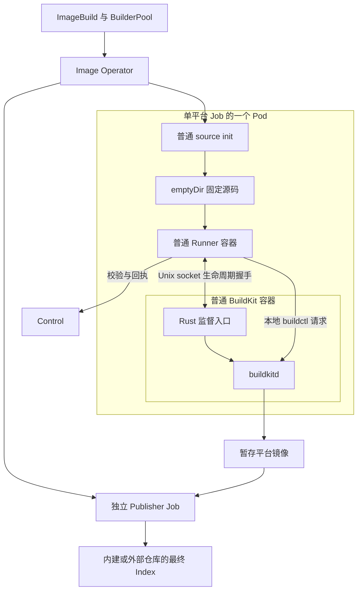

<!--
[INPUT]: 用户固定 Kubernetes 1.28 的要求、临时源码契约及 BuildKit rootless 约束。
[OUTPUT]: 定义双普通容器、进程收尾、权限边界及真实集群验收方案。
[POS]: 临时源码计划的镜像执行补充。实施状态以完成条件为准。
[PROTOCOL]: Update this header on change, then check AGENTS.md
-->

# Kubernetes 1.28 一次性镜像构建

## 问题与范围

正式集群为 Kubernetes 1.28.3。用户明确不升级集群。
现有实现把 BuildKit 放入可重启 init container。
该字段在 1.28 属于默认关闭的 Alpha 功能。
结构化 AppArmor 字段也超出 1.28 API。
只降低 Helm 版本门槛不能解决这些问题。

采用唯一实现：普通源码 init，加两个普通应用容器。
Runner 提交构建并回报。BuildKit 容器执行构建。
新增最小 Rust 监督程序，使 BuildKit 随单次任务退出。
删除原生 sidecar 路径，不添加版本分支或迁移代码。

继承原计划的固定 SourceManifest、每次直接检出、临时卷、独立 Operator、内外仓推送和双架构要求。
普通源码 init 本身不要求 Kubernetes 1.33。
原生设备执行、AI 规划、Gateway 和仓库存储拓扑沿用原计划。
本文替代原计划中的 1.33 版本门槛与目标选择条件。
部署目标固定为现有 1.28.3 集群。

## 需求与完成条件

| 编号 | 要求 | 完成依据 |
| --- | --- | --- |
| R1 | 直接支持默认配置的 Kubernetes 1.28 | 真实 1.28 API、kubelet 和 Job 完整执行通过 |
| R2 | 单一路径，无旧 sidecar 和版本开关 | 生成资源、Chart、代码和文档一致 |
| R3 | 每次检出固定源码，不保存源码缓存 | 普通 init、只读工作区和任务结束清理通过 |
| R4 | 保留 Runner 的凭据与进程边界 | BuildKit 不挂载任务、源码认证或 Runner 私有工作卷 |
| R5 | 正常与异常路径均停止 BuildKit | 成功、失败、崩溃、OOM、取消、超时和断联验收通过 |
| R6 | 保留双架构及内外仓发布 | 原生、显式仿真、Index、推送与拉取验证通过 |
| R7 | 支持能力以证据声明 | 先隔离验证，再部署正式 1.28；不复用 1.37 验收结论 |

## 方案取舍

| 方案 | 决定 | 原因 |
| --- | --- | --- |
| 打开 1.28 原生 sidecar Alpha | 不采用 | 需要变更集群开关，仍依赖实验行为 |
| Runner 放普通 init | 不采用 | init 结束后才启动 BuildKit，无法提交构建或回报结果 |
| Runner 与 BuildKit 合成一个容器 | 不采用 | rootless 无进程沙箱时，RUN 能接触该容器进程及其可读文件 |
| 两个普通容器，加显式退出握手 | 采用 | 1.28 可用，保留容器边界，任务有确定的结束条件 |
| 长驻共享 BuildKit 服务 | 不采用 | 增加跨任务状态、源码残留和容量隔离问题 |

`buildkitd` 不会发现目录后自动构建。
`buildctl` 是提交构建请求的官方客户端，不是额外服务。
保留现有 Runner 和 buildctl，避免重写 BuildKit 客户端协议。
监督程序只控制本地进程，不承接业务调度或持有任务令牌。

## 工作负载与数据流

下图表达职责与连接关系，不是实现代码。

每个平台仍对应一个 Job。
普通 init 成功后，Runner 与 BuildKit 容器并发启动。
Publisher 保留单容器 Job，无源码 init 和 BuildKit。
两个 Operator 继续作为独立 crate 和独立服务。

| 容器 | 可见材料 | 职责与权限 |
| --- | --- | --- |
| source init | 短期源码身份、源码认证、可写源码卷 | 检出和校验；结束前删除认证文件 |
| Runner | 任务 Secret、只读源码、私有工作卷、共享 socket | 硬化配置；校验、buildctl、脱敏日志、结果回报 |
| BuildKit | 状态临时卷、共享 socket、管理员 CA/配置 | rootless 构建；不挂载任务 Secret、源码认证和 Runner 工作卷 |

不启用共享 PID namespace，不挂载宿主容器运行时 socket。
普通应用容器不自动挂载 ServiceAccount token。
Git 凭据仍只进入源码 init。
BuildKit 通过 buildctl session 获得必要的仓库认证能力。
仓库凭据仍须限制目标仓库和有效期。
私有 CA 同时覆盖 daemon 仓库连接与 buildctl 令牌请求。
daemon 诊断进入 Runner 的限长脱敏通道，禁止监督程序直接回显凭据或未过滤的构建日志。

## 生命周期契约

### 启动、就绪与成功

1. 监督程序建立本地生命周期 socket。
2. Runner 重试连接，并保持唯一连接。
3. 监督程序接入后关闭监听器，移除监听路径。
4. 监督程序启动 rootlesskit 与 buildkitd。
5. 就绪必须同时满足进程存活及 `buildctl debug workers` 成功。
6. Runner 收到就绪后才提交构建。所有启动等待都有时限。
7. Runner 校验构建结果、镜像平台和固定源码，并排空构建日志。
8. Runner 请求停止。监督程序停止进程树并返回确认。
9. Runner 收到确认后提交平台结果，接受成功回执后退出 0。
10. BuildKit 容器正常退出 0，Job 才能完成。

停止确认仅证明受信监督程序完成收尾。
它不证明镜像正确，也不替代仓库 digest 校验。
停止确认失败时，不提交平台成功结果。
监督程序不读取任务 Secret。

### 崩溃、卡死与取消

| 事件 | 本地行为 | Operator 行为 |
| --- | --- | --- |
| Runner 非零退出、被杀或 OOM | 独占连接 EOF；监督程序停止 BuildKit 并失败退出 | 读取容器终止状态，终止该执行的其他平台 |
| Runner 卡死或连接不再前进 | 本地心跳租约到期，监督程序停止 BuildKit | 既有任务心跳和总 deadline 同时兜底 |
| BuildKit 提前退出，包括 exit 0 | 未进入约定停止阶段即视为失败；通知 Runner 取消 buildctl | 容器失败触发统一清理 |
| 监督程序被杀或 OOM | 容器 PID 1 退出，由运行时终止其容器内其余进程 | 发现失败容器并删除整个任务 Job |
| 用户取消或任务超时 | Runner 停止 buildctl；监督程序回收 BuildKit | 先写终态，再删除所属 Job/Pod |
| Operator 重启或短时不可达 | 本地连接租约与硬总期限仍生效 | 恢复后按持久终态继续清理，不重建已结束任务 |
| kubelet 不可达 | 本地期限仍生效；控制面不假定远端已停止 | 保留 CleanupPending，不强删 Pod 冒充清理完成 |

连接 FD 必须设置 CLOEXEC，禁止传入 buildctl。
Runner 的后台任务不得遗留连接引用。
协议只包含限长状态、心跳、停止和确认消息。
持续日志不能阻塞心跳或停止消息。
心跳采用单调时钟租约，不能无限延长任务总期限。
所有等待均受启动、停止或任务总期限约束。

监督程序处理 SIGTERM/SIGINT，先温和终止，再强制终止。
确认前必须等待进程树退出，不能只等待直接子进程。
监督程序作为 BuildKit 容器的 PID 1 和 subreaper。
使用该容器自身的 PID namespace，不再嵌套 rootlesskit PID namespace。
启动时核对实际 `/proc/1` 与 daemon namespace。
Runner 与 BuildKit 的 PID namespace 继续由容器运行时隔离。
停止窗口应小于 Pod 的 terminationGracePeriodSeconds。
初始目标为 15 秒内回收进程，Pod 保留 45 秒终止窗口。
具体计时以故障注入结果校准，不承诺断网节点的删除耗时。

### Kubernetes 1.28 的失败判定

不能只等待 Job 的 Failed 条件。
一个普通容器失败、另一个仍运行时，Pod 和 Job 仍能保持运行状态。
Operator 应读取所属 Pod 的 initContainerStatuses 与 containerStatuses。
非零退出或 OOM 立即进入失败收尾。
Pod→Job→ImageBuild 归属必须通过 UID 链确认。
未 Ready、调度等待和正常停止握手不等于失败。
成功只由完整 Job 完成条件与有效业务结果共同确定。
容量统计包含尚未清理的任务 Pod，避免失败瞬间释放并发额度。

### 结果确认与归属保存

Platform 与 Published 回报只保存已验证的候选结果。
Published 接受后不立即把业务任务改为成功。
相同执行与相同 digest 的重发必须得到幂等确认。
同一身份提交不同 digest 必须拒绝。

Control 复用 ImageBuild 的完整执行上下文校验。
交付时保存 CR UID，完成时核对该 UID 与 observedGeneration。
只有 Operator 确认完整 Job 成功且候选结果齐全，Control 才在事务内提交最终成功与制品记录。
事务复核取消、失败和 deadline。确认前的失败或取消阻止成功提交。
Control 重启后继续确认候选结果，不要求 Publisher 重做已完成的推送。
镜像已推送而最终确认失败时，保留对象供幂等重试，不伪造业务成功。

删除 Job 前，Operator 将所属 Job UID 与平台写入 ImageBuild status。
保存记录绑定当前 ImageBuild UID，数量按平台与 Publisher 有界。
后续状态更新必须保留该记录。
Job 被后台删除后，使用 Pod owner UID 与保存记录继续证明归属。
不能用名称前缀或普通标签替代 UID 证明。
Operator 重启后，残留 Pod 仍保持 CleanupPending 与容量占用。

## 安全、资源和镜像

### 1.28 安全配置

只为 BuildKit 容器设置 1.28 可用的 AppArmor 注解。
移除结构化 appArmorProfile 和可重启 init 字段。
BuildKit 按官方 rootless 要求使用独立安全配置。
Runner、Publisher 和 source init 保留已有硬化配置。

rootlesskit 的 UID/GID 映射助手需要实际权限。
不能把 Runner 的 allowPrivilegeEscalation=false 和 drop ALL 原样套入 BuildKit。
最终权限必须通过目标节点的 rootless 启动验收确定。
不使用 privileged、hostPID 或宿主目录挂载来绕过失败。
准入例外只覆盖构建工作负载，不放宽 Control、Gateway 和 Operator。

默认 1.28 关闭 `ProcMountType`。
正式服务端把 `procMount: Unmasked` 重置为 `Default`。
额外嵌套 PID namespace 时，受遮罩的 `/proc` 无法重新挂载。
正式 worker 已验证容器自身 PID namespace 与 native snapshotter 可执行真实 `RUN`。
因此采用上述单一路径，不要求开启 Alpha 功能。

`--oci-worker-no-process-sandbox` 仍有明确边界。
任务只运行可信项目源码；rootless 不构成恶意租户沙箱。
独立容器保护 Runner 文件和 PID。
RUN 能看到 BuildKit 容器内的监督进程，不保证监督程序抵抗恶意 RUN。
若以后执行不可信租户代码，应单独设计 VM 或受支持的沙箱运行时。

### 资源与架构

保留现有 Runner 与 BuildKit 的独立资源预算。
例如各请求 1 CPU、2 GiB，Pod 常驻请求仍合计 2 CPU、4 GiB。
普通 init 与应用阶段取峰值，不能把双容器成本算成一个容器。
源码、BuildKit 状态、Runner 工作目录和 socket 全部使用 emptyDir。
内存卷计入内存消耗。临时磁盘总量不能按单个卷的 sizeLimit 计算。
每个任务保留 Pod 级临时存储限额与磁盘压力失败验收。

优先使用原生 amd64/arm64 节点。
正式集群当前六个节点都是 amd64，不能据此验收原生 arm64。
arm64 构建走现有显式仿真授权和已验证的节点标签。
节点能力验收包含真正的 arm64 RUN，不能只验证镜像元数据。
不让 Operator 自动部署特权 binfmt 安装器。

### 镜像交付

增加专用 BuildKit 运行镜像，基于固定版本 rootless 镜像和 digest。
只加入最小 Rust 监督程序，保留官方 rootlesskit、runc、UID/GID 助手和目录布局。
监督程序使用匹配运行镜像 ABI 的静态产物。
amd64/arm64 均验证运行产物，禁止把 Debian glibc 二进制直接复制进 Alpine 镜像。
现有 worker 镜像继续提供 Runner、Publisher 和 buildctl。
BuilderPool 的 buildkitImage 直接引用新运行镜像，无旧镜像兼容探测。
镜像发布、固定 digest、验收夹具和版本校验同时接入新镜像。

## API 与 SDK 支持范围

现有 kube 5.0.0 上游仅声明测试 Kubernetes 1.33 及以上。
k8s-openapi 0.29.0 也没有 v1_28 编译 feature。
这不等于项目必须升级集群，也不代表编译成功就支持 1.28。

项目当前 watcher 默认使用 ListWatch。
未启用 streaming_lists 或聚合 discovery。
先保留依赖版本，明确只生成 1.28 可用字段。
独立 1.28 服务端必须验证 CRD CEL、list/watch、Lease、status patch、TokenReview、投射 token 和 Job 行为。
若发现真实客户端不兼容，先在实施中解决依赖问题，再声明支持。
不按服务端版本保留两套资源或调度路径。

## 实施单元

依赖顺序：U1 → U2 → U3。U4 跟随 U1/U2，U5 汇总前四项。

- [x] **U1：监督进程与生命周期协议**

**要求：** R4、R5。无集群变更依赖。

**文件：** 新增 `operators/image-operator/src/buildkit.rs`、`src/lifecycle.rs`、`src/bin/buildkit.rs`，并在前两个模块加入协议和 Linux 真实进程测试；修改该 crate 的 `Cargo.toml`、`src/lib.rs`、`src/worker.rs` 和相应模块地图。
这些 `src/`、`tests/` 路径均相对 `operators/image-operator/`。

**实现：** 生命周期与进程树控制分开。沿用现有 Tokio、取消令牌、日志脱敏和进程回收约定。
监督程序只接收管理员配置与非敏感 deadline。复用 Runner 的认证回报和构建结果校验。

**测试：** 双向启动顺序；就绪超时；正常 Stop/确认；Runner SIGKILL、卡死及 FD 继承；daemon exit 0/非零早退；重复停止；孙进程忽略 TERM；停止超时；日志阻塞不影响租约；回执失败不能成功退出。
Linux 测试使用真实进程树。每项断言退出码、时间上界及无遗留进程。

- [x] **U2：1.28 工作负载与权限边界**

**要求：** R1–R4。依赖 U1。

**文件：** `operators/image-operator/src/resources.rs`、`src/resource_tests.rs`、`src/api.rs`；新增 `operators/image-operator/Dockerfile.buildkit`；更新两个 Image CRD 副本、`charts/artifactory-image-operator/values.yaml` 和对应模块地图。
状态中的 Job UID 记录采用类型化契约，生成 CRD 双副本必须一致。

**实现：** BuildKit 移至普通 containers。接入新监督程序和 IPC 卷。
保留普通 source init、独立 Runner 私有卷和 Publisher 单容器模式。
只在 BuildKit 使用所需安全例外。定义资源、总期限和终止窗口。

**测试：** 资源生成无 restartable init 和结构化 AppArmor；注解准确指向 BuildKit；不共享 PID；所有敏感卷只能被指定容器挂载；不同架构调度与显式仿真；Publisher 无 BuildKit；容器资源合计正确；1.28 服务端严格验证 Job 与 CRD。

- [x] **U3：容器失败与清理收敛**

**要求：** R5。依赖 U2。

**文件：** `operators/image-operator/src/controller.rs`、`src/resources.rs`；新增 `operators/image-operator/tests/controller_lifecycle.rs`；修改 `crates/control-plane/src/images/dispatch.rs`、`src/store/images.rs` 及 `crates/control-plane/tests/database/image_regressions.rs`。
Control 新增保存字段时同步其 `migrations/migrations/0000_baseline.sql` 与存储查询，不添加旧数据迁移。

**实现：** 通过 UID 链读取所属 Pod 状态。
保留先写终态、再删资源的顺序。失败、取消和 deadline 收尾幂等。
清理期间继续占用实际容量。成功材料回收不能改为取消。
删除前持久化 Job UID，清理重放不依赖已删除的 Job。
Control 将候选结果回报与最终成功提交分开。
最终提交复用现有构建锁顺序和事务，不新增协调服务。

**测试：** Runner 失败但 BuildKit 仍活；BuildKit OOM 但 Job 未失败；源码 init 失败；无关 Pod 同名；停止握手中未 Ready；Operator 重启；其他架构仍活；取消与完成并发；kubelet 不可达保留清理状态和并发占用。
补充 Job 已删除但 Pod 残留时重启；UID 保存失败时禁止删除；状态更新不丢 UID 记录。
补充 Published 已接受后 OOM/非零退出、回执丢失重试、Control 重启、CR UID 替换、候选 digest 冲突和成功确认前取消。
每项断言数据库、ImageBuild 与制品记录一致，成功只提交一次。

- [x] **U4：发布与最低版本契约**

**要求：** R1、R2、R7。依赖 U1/U2。

**文件：** 两个 Operator Chart 的 `Chart.yaml`；`.github/workflows/deployment-images.yml`、`release-images.yml`；`scripts/version.py` 及其测试；对应模块地图。

**实现：** 新 BuildKit 运行镜像纳入 SHA 与双架构发布。
两个 Operator Chart 的最低版本统一为 1.28。
精确更新项目镜像白名单，不全局替换第三方镜像地址。
移除把 1.33 当作现行要求的代码说明与运维说明。

**测试：** 1.28 版本下 Helm lint/template；镜像产物可启动且 ABI 正确；Release 清单包含新镜像；BuilderPool 引用匹配监督程序入口；生成 CRD 无漂移。

- [ ] **U5：隔离验收、文档和正式部署**

**要求：** R1–R7。依赖 U1–U4。

**文件：** `.github/workflows/ci.yml`；`tests/operator/acceptance/prepare.py` 及其依赖；新增 `tests/images/` 下的 1.28 生命周期验收；`scripts/check_ephemeral_source.py`、`test_ephemeral_source.py`；`docs/image-builds.md`、`helm.md`、`operator-operations.md`、原临时源码计划、验收记录及各层地图。
新增目录必须先提供模块地图。

**实现：** 增加真实 1.28 Job 验收，使用已验证的 kind/node/kubectl 组合和固定 digest。
不把现有 1.37/Cilium 1.20.4 组合直接降 Kubernetes 版本。
1.28 生命周期测试先使用相容 CNI；NetworkPolicy 在正式 CNI 单独验证。
默认关闭 SidecarContainers 开关，记录证据。

**验收：** amd64 原生、arm64 原生及显式仿真、双平台 Index；内外仓推送、私有 CA、Gateway 拉取；源码失败、构建失败、Runner/BuildKit/监督程序分别被杀或 OOM、取消、总超时、Operator 重启、控制面故障及节点断联。
记录最终 digest、退出码、容器状态、回收时长和材料清理结果。
检查 BuildKit 无任务 Secret 和 Runner 私有卷。保留去敏证据。

**部署顺序：** 隔离环境通过 → 正式节点能力预检 → 发布不可变镜像 → 排空旧业务 → 按原计划切换与验收。
正式数据库、PKI、S3 和 Registry 的操作边界沿用原计划。
本方案未实施前，不因版本要求而重置正式数据库。

## 仍须由实施验证的事项

- 六个正式节点的 userns、subuid/subgid、运行时、AppArmor 和准入策略。
- 固定 rootless 镜像在目标内核上的 snapshotter 和 `/proc` 隔离行为。
- 新监督程序的静态构建及双架构运行产物。
- kube 5.0.0 对本项目实际 1.28 操作的完整验证。
- 真实 arm64 节点与 amd64 仿真节点的验收条件。
- 终止计时、磁盘压力和正式 CNI 网络边界。

这些事项是上线前的验收条件，本文未将其标记为通过。
若目标节点不满足 rootless 条件，先给出具体节点配置差异，再实施最小调整。
不得静默切换为特权构建。

## 依据

- 原计划：[临时源码与任务独立拉取](2026-11-18-ephemeral-source-execution.md)。
- 当前实现：`operators/image-operator/src/resources.rs`、`worker.rs`、`controller.rs` 和 `Dockerfile.worker`。
- [Kubernetes 原生 sidecar 生命周期](https://kubernetes.io/docs/concepts/workloads/pods/sidecar-containers/)。
- [Kubernetes 1.28 AppArmor 注解](https://v1-28.docs.kubernetes.io/docs/tutorials/security/apparmor/)。
- [BuildKit v0.26.2 rootless 权限与无进程沙箱边界](https://github.com/moby/buildkit/blob/v0.26.2/docs/rootless.md)。
- [BuildKit rootless Kubernetes 示例](https://github.com/moby/buildkit/blob/v0.26.2/examples/kubernetes/deployment%2Bservice.rootless.yaml)。
- [官方 daemonless 入口仍启动 daemon 与客户端](https://github.com/moby/buildkit/blob/v0.26.2/examples/buildctl-daemonless/buildctl-daemonless.sh)。
- [RootlessKit v2.3.5 进程模型](https://github.com/rootless-containers/rootlesskit/blob/v2.3.5/docs/process.md)。
- [kube 5.0.0 上游测试范围](https://docs.rs/crate/kube/5.0.0)。
- [kube-runtime 5.0.0 watcher 默认策略](https://docs.rs/kube-runtime/5.0.0/src/kube_runtime/watcher.rs.html)。
- [kube-client 5.0.0 discovery 实现](https://docs.rs/kube-client/5.0.0/src/kube_client/discovery/mod.rs.html)。
