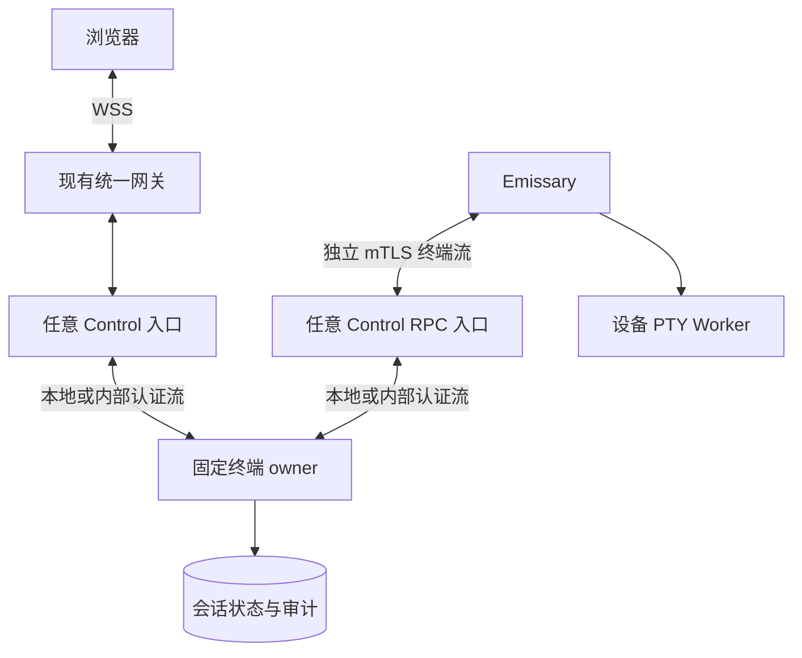

<!--
[INPUT]: 当前设备协议、租户权限、Control 多副本和 Uplink/Tunshell 源码核验。
[OUTPUT]: 提供被控设备网页终端的现状评估、架构建议和实施计划。
[POS]: 控制台远程设备终端的规划文档；不声明实现或验收完成。
[PROTOCOL]: Update this header on change, then check AGENTS.md
-->

# 从控制台打开被控设备终端

## 结论与确认范围

现有基础支持增量建设网页终端。需要新增交互会话服务，不能直接复用构建日志接口。

用户已明确：“只需从控制台打开被控设备终端”。本计划只覆盖浏览器中的远程设备交互字符终端。控制台提供操作入口，Control 认证并转发会话，Emissary 在被控设备上启动和监督 PTY。

首版目标是可靠执行、明确身份、及时回收。终端需要支持交互命令、Ctrl+C、窗口调整和全屏 TUI。设备不开放新的入站端口，也不要求开启 SSH。

### 目标边界

唯一执行目标是当前租户的被控设备。Emissary 通过出站 mTLS 和独立终端流接入，Shell 使用设备专用服务账户，覆盖该账户可访问的设备资源。

控制平面自身、其容器、本机和宿主机的 Shell 均不在范围内。不增加平台终端入口、平台账户允许名单或 Control 本地 PTY Worker。

这里的“打开”不包括在设备物理桌面弹出 Terminal、iTerm 或 PowerShell 窗口。Windows 服务位于 Session 0；桌面弹窗需要单独的用户会话代理。首版也不提供 SSH 网关、文件传输界面、终端协作、输入自动重试、跨进程重启保活或 AI 自动操作。

## 当前代码事实

以下结论来自本次源码读取。没有运行应用、测试、部署或设备命令。

- `proto/artifactory/emissary/v1/emissary.proto` 已有双向 `Control.Connect` 与独立 `UploadLogs`，没有终端 RPC。
- `crates/emissary/src/client.rs` 已校验 CA、SAN 和 TLS 1.3。`crates/control-plane/src/grpc.rs` 按实际客户端证书识别节点，并替换旧 session。
- `crates/control-plane/src/state.rs`、`coordination.rs`、`store/replication.rs` 已有进程实例 UUID、设备连接归属、持久命令和围栏。没有按实例寻址的终端转发服务。
- `crates/emissary/src/worker.rs` 的构建子进程清空继承环境，并设置空 stdin。日志 spool 是可重放日志，不是实时终端。
- `crates/execution-support/src/process.rs` 已有 Unix 进程组、Windows Job Object 和取消回收。尚无 PTY、ConPTY 或窗口调整。
- `crates/emissary/src/service.rs` 拒绝 root 和 LocalSystem 服务账户。终端仍能读取同账户的其他构建目录、节点配置与私钥；清空环境不构成项目沙箱。
- `crates/control-plane/src/auth.rs` 区分账户身份、租户角色和项目权限。设备终端必须检查当前租户权限，不能依赖历史 `users.role`。
- `docs/multitenancy.md` 允许普通成员读取获授权项目的设备。项目构建权限不包含主机 Shell 权限。
- `web/src/components/node-detail-dialog.tsx` 的五标签是概览、资源、工具链、元数据和运维。`Terminal` 图标只表示工具链。
- `web/src/components/nodes-workspace.tsx` 会在筛选或分页后销毁详情。详情标签也按条件挂载，不能承载长会话的唯一状态。
- `web/src/components/ui/dialog.tsx` 捕获 Escape；`command-palette.tsx` 捕获 Ctrl/⌘K。终端必须保留这些字符的输入语义。
- `crates/gateway/src/http.rs` 已按路径转发 API，并有连接预算。它没有本功能的 WebSocket 验收证据；现有 30 秒设置是上游回池空闲时限，不能直接当作终端寿命。
- `charts/artifactory/templates/control-plane.yaml` 使用非 root、只读密钥挂载和多副本。终端内部转发仍需新增受限端口与实例寻址，不需要在 Control 内执行 Shell。

`docs/solutions/` 不存在。现有设备详情约束见 `todos/011-complete-p2-device-detail-design.md`，历史上线记录见 `docs/releases/2026-11-21-device-detail-kubernetes.md`；两者不构成终端验收。

## 需求与交付标准

### 目标和交互

- R1：设备详情运维区提供“打开终端”。在线、已启用且具备终端能力时允许创建；离线不排队。
- R2：独立终端工作区展示目标、系统、实际账户、初始目录和状态。会话不受设备列表刷新、分页或详情标签卸载影响。
- R3：支持字节输入输出、Ctrl+C、Escape、resize、中文输入与全屏程序。输入不自动重放。

### 权限与生命周期

- R4：设备终端首版仅允许当前租户 owner/admin 的登录 Session，且设备端独立启用。项目授权和 API Token 不授予终端能力。
- R5：创建、附着、重连和运行期均复核身份。退出、撤权、设备吊销与超时会关闭会话，并回收进程树。
- R6：同一页面保留原终端渲染器时，短时断网允许附着原会话。刷新、新标签和渲染器重建不恢复原画面；Control owner、Emissary 或设备启动身份变化后终止旧会话。不承诺跨重启迁移。

### 运行约束

- R7：终端流不进入构建日志、遥测、业务事件正文或数据库逐字节存储。大输出不能堵塞心跳、取消和 OTA。
- R8：三副本下浏览器、设备控制流和设备终端流落到不同副本时仍可工作。终端 owner 故障后明确结束；非 owner 浏览器入口故障按 R6 恢复。设备终端流或其内部转发流中断则结束，不重复启动 Shell。
- R9：默认只审计会话元数据。全程录制属于后续独立能力，不能把元数据审计宣传为命令级审计。
- R10：保留 Kubernetes 1.28 支持。设备先验证 Linux/macOS 与 Windows x64；其他架构按真实设备覆盖单列。

## 技术方案建议

下面描述责任和数据流，不预写实现代码。

### 1. 设备会话与租户权限

Control 会话服务负责创建、附着、限流、超时、退出原因和审计。设备 supervisor 负责启动和监督 PTY。会话直接绑定租户、设备、操作者和设备启动身份，不引入多种执行目标的适配器。

授权使用当前租户的设备归属和 owner/admin 角色。设备本地必须独立启用终端；构建授权、项目成员角色和设备可见性不能替代 Shell 授权。界面只在设备运维区提供入口，不增加账户级平台运维页面。

设备 Shell 意味着信任该设备服务账户。终端不是项目沙箱；即使清空环境，同账户仍能读取设备配置、私钥和其他构建目录。因此该入口只面向设备运维人员，不能通过过滤命令来模拟项目隔离。

### 2. 将控制消息与终端字节分开

保留 `Control.Connect` 传递少量开关、启动和停止通知。增加独立终端双向 RPC，复用设备证书认证与公网端口，但使用独立队列、字节预算和客户端通道。

新增 RPC 必须显式校验设备证书。注册监听允许无客户端证书，不能因为 RPC 位于同一 TLS 监听就认为已经完成 mTLS 授权。

Open 命令绑定终端 ID、设备 ID、设备 startup/session、owner 实例及期限，使用独立持久控制记录。不能套用必须关联 build attempt 的 `device_commands`。重复通知只启动一个 Worker；已过期或已经结束的 Open 不执行。收到浏览器有效附着后才允许启动 PTY，创建记录本身不启动进程。

### 3. 明确三副本的流路由

每个终端固定一个 `terminal owner`，选择当前设备控制连接所在的 Control 实例。会话创建事务核对实例状态、设备 session 和 startup，关闭后不重新分配 owner。这个实例是内部转发节点，不是用户选择的 Shell 目标。

新增带租约的实例目录，登记进程 UUID、受信内部地址和就绪状态。Kubernetes 使用部署注入的 Pod 地址及内部专用端口；本机多实例使用运维配置的地址。目录地址不接受浏览器参数或设备自报值。内部服务校验证书身份、实例租约及目标 UUID；地址复用不能让新进程冒充旧 owner。

浏览器 WSS 和新设备终端 RPC 都可能落到任意实例。入口查询会话 owner；若 owner 非本机，经过内部认证流转发到 owner。浏览器入口验证 Cookie 后，只转发绑定会话的短期身份委托，不向其他实例转发可复用 Cookie。设备入口验证实际证书后，传递绑定节点、session 和终端的身份。owner 再校验当前会话与委托，不能信任普通 HTTP header。

内部流继续采用固定端点、服务证书和禁止重定向的传输约束。实例目录写入使用 Control 服务身份；设备证书不能登记实例或签发身份委托。每次进程启动登记独立实例公钥，内部握手证明持有对应私钥，并核对目录租约；不能只凭共享服务证书声称某个 owner UUID。拒绝任意 URL、过期实例、转发循环和公开入口访问。新增私有端口的 Service、NetworkPolicy、证书用途和连接限额属于同一实施单元。现有 service-transport 不能直接当作该认证双向流的实现。

PostgreSQL 保存会话控制状态、租约、票据摘要和审计。NOTIFY 仅唤醒控制动作；有界轮询补偿。终端字节只经过内存有界流，不能放进 outbox 或 LISTEN/NOTIFY。首版不新增 Redis 或消息队列。

### 4. 票据与公开接口

以下为建议资源边界，实施时与现有 API 规范同步。

- `POST /api/v1/nodes/{id}/terminal-sessions`：租户 Session、CSRF、设备授权、幂等创建。
- `POST /api/v1/terminal-sessions/{id}/attach`：复核会话所有权、原登录 Session、渲染器和目标权限，产生一次性附着票据。
- `GET /api/v1/terminal-sessions/{id}/stream`：WSS 升级；严格验证配置的 Origin，包括 scheme、host 和 port。
- `POST /api/v1/terminal-sessions/{id}/close`：原创建者及原登录 Session 幂等结束自己的会话。目标权限已撤销时仍允许清理，不返回目标内容。终态原因仅向原会话所有者提供。

创建、附着和关闭使用现有 HTTP wrapper 与 CSRF。WebSocket 无法自定义租户 header，握手从服务端会话记录确定作用域，不能从 query 中选择租户。终端会话路由须增加专用资源授权；现有 `TenantState` 不认识 `terminal-sessions`，不能直接机械套用。

票据只存摘要，绑定账户 Session、终端、目标和附着代次。票据通过 WSS 第一帧提交，不放 URL、localStorage 或日志。验证完成前不启动 PTY、不发送输出、不接受输入。初始建议：票据 30 秒有效，升级后 5 秒内完成认证。设置未认证连接数上限；原子消费票据，拒绝双用。

会话仅属于创建者账户及原登录 Session。即使拥有相同目标的运维权限，其他账户或同一账户的新登录 Session 也不能附着、读输出或接管。首版不提供管理员代看、跨标签接管或他人会话强制终止界面。

每个会话仅允许一个输入附着。首次附着登记随机渲染器标识，仅保存在页面内存。网络重连必须保留同一渲染器及消费偏移，并原子提升附着代次；旧连接立即停收输入和停止重连。新标签或刷新后的空渲染器拒绝附着，页面提供显式结束旧会话与新建操作。重连只附着原终端，不自动创建终端，也不重发旧输入。

### 5. 会话与进程生命周期

状态为 `pending → opening → active → closing → closed`，失败进入 `failed`。`attached/detached` 是附着属性；浏览器显示 connecting、running、reconnecting、exited 或 error，并附上原因。

只有设备完成真实 PTY 创建并返回 ShellStarted 后才进入 active。发送启动通知、连接成功和会合成功都不代表 Shell 已启动。结束记录区分实际 Shell 退出码、信号和连接错误；不能把会话函数正常返回当作进程退出成功，也不把所有非零退出码压成 1。

建议初始预算如下。这些是实施起点，需要负载和设备验收，尚非实测指标。

- 创建等待附着最多 30 秒，启动最多 15 秒；超时清理控制记录与已启动 Worker。
- 浏览器断开后停收输入，保留原 PTY 最多 30 秒；超时结束。
- 设备执行租约 45 秒，每 10 秒续期；失去 owner 续期后到期回收。
- owner 每次成功复核账户、当前角色、设备授权状态和证书时效后，只授予最多 5 秒的转发授权。输入输出路径按单调时钟检查截止。复核查询与连接池等待的超时短于剩余授权期限；到期不等待挂起查询，立即停止转发与输入，关闭并撤销设备租约。正常连通时以 5 秒为撤权上限；链路分区时设备进程最多存活到 45 秒租约到期。
- 默认输入空闲 15 分钟、最长 2 小时；纯输出不延长输入空闲计时。
- 默认每用户最多 2 个、每设备最多 2 个会话。限额由数据库原子准入，设备另设本地硬上限。每副本初始最多承载 64 个 owner 会话与 128 条入口转发流，并给网关终端连接独立配额，保留普通 HTTP 与构建控制容量。

会话关闭后不续租、不重新创建进程。DB 或权限服务失效时不能继续沿用旧授权；在复核窗口内终止附着。服务端 close、设备本地关闭与清扫器都可幂等推进终态，owner 崩溃由租约和清扫补齐。

首版只恢复浏览器一侧的网络闪断。设备终端 RPC 或设备到 owner 的内部字节流断开时，立即结束会话并回收 Worker；不尝试缺少生产端重放协议的续传。浏览器入口到 owner 的流断开则进入 R6 的恢复窗口。两类失败都显示具体原因。

PTY Worker 复用独立进程和父子管道监督思路。不能只依赖 Rust Drop。Linux/macOS 需要处理控制终端、独立会话、后台子进程与父进程突然退出；Windows 需要验证 ConPTY 与 Job Object 的创建和回收顺序。进程回收范围必须有真实后代进程证据，不能把单 PID kill 当作进程树回收。

设备 session/startup 替换、吊销、服务停止和 OTA drain 都停止接收新终端。OTA 先请求关闭，再在有限期限内强制回收，不能无限等待用户退出。终端不占用构建 slot；独立限额与资源预算约束其开销，也不能承诺终端命令不会影响同账户构建。

### 6. 字节协议、背压和桌面行为

采用 `@xterm/xterm` 与 fit addon，按需加载。前端负责渲染，后端负责终端服务。PTY 输出传原始字节，交由终端连续解码；不逐消息有损转换 UTF-8。输入区分文本 UTF-8 与二进制输入。

协议包含 StartShell、ShellStarted、输入、输出、resize、已消费输出 ACK、心跳和退出原因。StartShell 在认证后携带受限的终端类型、初始行列与 Shell profile；设备实际创建 PTY 后回复 ShellStarted。输出有单调字节偏移；输入只对当前连接做序号去重，断线后禁止补发。resize 校验行列上下限，合并短时重复事件。首版不提供 TCP/UDP 端口转发消息，未知或越界消息明确拒绝。

浏览器在 xterm `write` 回调后 ACK 已消费字节。PTY 读取、RPC、内部转发和 WSS 全链路使用高低水位。建议输出帧最多 16 KiB，owner 的每会话在途及重连环形缓冲总预算 1 MiB，重连保留最多 30 秒；各转发进程和设备端每会话队列也不超过 1 MiB，另外核算传输库与系统 socket 缓冲。ACK 窗口耗尽时暂停读取。达到保活时限或持续拥塞时明确关闭，不静默丢字节。重连请求的偏移早于保留窗口时，报告输出缺口并结束该会话；不能把残缺 TUI 伪装成完整恢复。

输入帧建议最多 16 KiB，多行粘贴分帧、限流并明确确认。终端中的 Escape、Ctrl+C、Ctrl+K 交给 PTY；提供可见的焦点退出和结束按钮。剪贴板操作由用户触发，默认禁用 OSC 52；启用链接时只允许 HTTP/HTTPS，用户点击后用隔离 opener 的方式打开，不执行输出中的 HTML 或自动打开链接。

终端区不加载第三方分析脚本。设备默认仅提供已配置 Shell profile 与固定安全初始目录，不接受任意可执行路径、环境变量或任意 cwd。Shell 环境使用 allowlist，不继承 Emissary 设备认证变量、云凭据或任务签名变量；控制消息不携带 Control 的私有凭据。页面仍明确展示实际设备账户的权限范围。

### 7. 视图与审计

终端工作区独立于设备详情和列表挂载。首版可用一个活动视图展示一个会话；数据库和协议按会话隔离。同一渲染器保留屏幕、光标和终端模式时才能从 ACK 偏移恢复。刷新、页面崩溃或新标签只有空渲染器，首版明确显示“无法恢复终端画面”，不附着到原 PTY。用户可结束旧会话后显式创建新会话；无操作的旧会话由 30 秒恢复窗口回收。不从浏览器持久化秘密，也不引入服务端终端快照来扩大首版范围。

切换设备详情不结束终端。关闭终端视图代表结束该会话；浏览器异常消失进入 30 秒恢复窗口。切换租户、注销与权限丢失清空画面并结束对应附着。显式关闭失败时仍由租约和清扫回收。

创建过程沿用顶部细进度条；后台字节和重连不触发全局加载。持续状态留在终端区，一次性失败用顶部 notify。

审计保存操作者、目标、账户、创建/结束时间、原因和字节计数，不保存票据、键盘输入、环境或原始输出。创建与准入审计同事务提交；关闭事件由终态事务和清扫补齐。初始保留建议 30 天，实施时接入现有归档和租户删除策略。未录制会话不能追溯完整输入命令。

## Uplink 与 Tunshell 源码借鉴评估

2026-11-24 下载并读取固定源码快照，未编译、运行或连接其公共终端服务。以下判断是源码适配评估，不代表部署验收或完整安全审计。

### 核验对象

- Uplink：`bytebeamio/uplink` main，提交 `e94a67186d64b3a38233da1afdafc966082f4492`，版本 2.18.5，Apache-2.0。
- Uplink 实际依赖：`bytebeamio/tunshell` 的 `bytebeam-changes` 分支；Cargo.lock 固定 `2c3b7b7a68da8452289fc089c352221a3e7abd55`，提交日期 2024-12-14，MIT。不能用 fork 默认 master 代替这个版本。
- Tunshell 上游：`TimeToogo/tunshell` master，提交 `1f0575b8785d9e8af236a5095b904c93ec08db32`，提交日期 2026-07-05，MIT。本次 GitHub 元数据为未归档；不能称其停止维护。近期提交也不代表其依赖栈已完成更新。

### 实际集成及可采纳模式

Uplink 启用远程 Shell 后注册 `launch_shell` action。MQTT 下发 `{session, relay, encryption}`，collector 以内嵌 Rust library 的 Target 模式建立独立终端连接。终端字节不经过 MQTT。[S1]

这直接支持当前方案的控制消息与终端字节分离。Artifactory 继续使用 `Control.Connect` 触发设备建链，无需增加 MQTT。每个终端由独立受监督 Worker 执行，并受设备限额、取消令牌和租约约束。

Tunshell 的消息区分 StartShell、ShellStarted、Stdin、Stdout、Resize 与 Exited。开始请求协商终端类型和窗口尺寸；所选后端创建成功后回复 ShellStarted，并区分 LocalPty、RemotePty 与 Fallback。因此该消息本身不保证真实 PTY；Artifactory 只接受真实 PTY/ConPTY 的启动确认。协议分层和后端就绪确认值得采用，不要求与其 wire format 兼容。[S2]

上游同时提供 Rust rlib/cdylib 与浏览器 WASM。浏览器通过小型 TerminalEmulator 接口衔接 xterm，传输 Uint8Array，并在 xterm write 回调后完成写入 Promise。当前 React 页面可以借鉴该适配边界；无需为了终端渲染额外引入 WASM。[S3]

### 不能直接替代现有设计的部分

1. **身份与票据。** Tunshell 的两枚 relay key 用于两端会合，加密秘密另由浏览器生成。relay key 持久明文保存，加入检查主要是 key 归属和一天有效期，没有当前方案要求的原子一次性消费、设备证书与租户授权。浏览器和设备仍须分别认证并绑定本会话角色，不能复用一个 bearer key 替代 mTLS/RBAC。[S4]
2. **高可用。** relay 保存本机 SQLite 会话，待会合 socket 与活动任务放在进程内连接表。共享数据库也不会共享活连接。独立部署 relay 可以改变 Control 的字节路径，但会新增服务并仍需固定会话归属；不能据此删除 U3。[S5]
3. **直连与加密。** 原生客户端尝试 TCP/UDP 直连，浏览器通过 WSS relay。首版不引入 P2P/打洞。其 AES-256-GCM 层只对不持有加密秘密的 relay 隐藏内容；若 Control 代发或保留秘密，Control 仍可解密。当前 WSS/mTLS 提供逐跳保护，不宣称端到端加密；未来若要求 relay 不可见，另定密钥分发、消息顺序和审计边界。[S4][S6]
4. **依赖与公开 API。** fork 和当前上游仍声明 Tokio 0.2、portable-pty 0.3.1、旧 TLS/WebSocket 依赖。Uplink 使用 tokio-compat-02。公开 Client 负责整套 relay 与加密协商，ShellServer/PTY 不是可直接接入现有 gRPC 的公开库接口。整库接入需要运行时迁移或隔离、传输改造与依赖检查，不能把存在 rlib 当作已兼容 Tokio 1。[S1][S7]
5. **流控与恢复。** 有界队列和 await write 值得参考，但 Shell 协议没有浏览器消费偏移 ACK、恢复游标或字节 credit，WASM WebSocket 层也存在未设字节硬上限的缓冲。它没有提供当前方案的刷新恢复或多副本迁移依据；仍需自己的 ACK、队列预算和回收机制。[S2][S8]
6. **目标能力。** PTY 失败时会退到 remote-pty 或功能有限的 pseudo-shell；Windows 默认 Shell 取 ComSpec/cmd.exe。Artifactory 应按设备配置选择 profile，真 PTY/ConPTY 不可用时明确失败，不静默降级。最新上游还带 TCP/UDP 端口转发；整体复用时必须在协议层删除或拒绝，不能只隐藏界面。[S9]

Uplink 的集成还暴露了本方案应避免的具体问题：[S1][S10]

- `ShellSpawned` 在 start_session 之前发出，不是设备已创建 Shell 的证据。
- collector 读取 action 后持续 spawn，没有活动会话表与运行并发上限；有界等待队列不能替代运行限额。
- cancel_action 被转到原 collector，但该 collector 统一按 Keys 解析，没有会话取消与进程树回收分支。
- bridge 用 Debug 记录完整 Action；payload 含会话与加密秘密，沿该路径会写入日志。
- fork 的 Target 会话正常返回固定映射为 0；PTY 非零退出状态压成 1，不能表达精确进程结果。

### 采用建议与 M0 判据

默认路线是借鉴控制/数据分离、启动握手、字节协议和渲染适配，保留现有 mTLS/gRPC、租户授权、一次性票据、owner、租约和进程监督。PTY 继续优先验证现代 portable-pty，不立即增加旧版 tunshell-client 生产依赖。

直接复用 Rust+WASM+relay 保留为候选路线。M0 若验证该路线，必须固定 SHA、自托管端点、保留许可声明，并验证 Tokio 1 适配、实际 Shell 退出码、硬取消与后代回收、权限撤销、密钥不落日志、网络转发拒绝和三副本归属。完成后再判断其维护成本，不能仅凭单会话成功就替换默认架构。

Uplink 代码与 Tunshell 依赖分别遵循 Apache-2.0 和 MIT。直接复制代码时，按具体来源保留版权、许可与适用的 NOTICE，不能把 Uplink 的许可证套到其依赖。

### 固定版本源码依据

- [S1 Uplink 依赖](https://github.com/bytebeamio/uplink/blob/e94a67186d64b3a38233da1afdafc966082f4492/uplink/Cargo.toml#L42)；[锁定版本](https://github.com/bytebeamio/uplink/blob/e94a67186d64b3a38233da1afdafc966082f4492/Cargo.lock#L3365)；[collector](https://github.com/bytebeamio/uplink/blob/e94a67186d64b3a38233da1afdafc966082f4492/uplink/src/collector/tunshell.rs#L19)。
- [S2 Shell 协议](https://github.com/bytebeamio/tunshell/blob/2c3b7b7a68da8452289fc089c352221a3e7abd55/tunshell-client/src/shell/proto.rs#L6)；[实际启动确认](https://github.com/bytebeamio/tunshell/blob/2c3b7b7a68da8452289fc089c352221a3e7abd55/tunshell-client/src/shell/server/mod.rs#L54)。
- [S3 上游 WASM API](https://github.com/TimeToogo/tunshell/blob/1f0575b8785d9e8af236a5095b904c93ec08db32/tunshell-client/src/wasm.rs#L17)；[xterm 消费回调](https://github.com/TimeToogo/tunshell/blob/1f0575b8785d9e8af236a5095b904c93ec08db32/website/components/term/index.tsx#L72)。
- [S4 双端 key](https://github.com/bytebeamio/tunshell/blob/2c3b7b7a68da8452289fc089c352221a3e7abd55/tunshell-server/src/api/routes/create_session.rs#L6)；[加入校验](https://github.com/bytebeamio/tunshell/blob/2c3b7b7a68da8452289fc089c352221a3e7abd55/tunshell-server/src/relay/server/session_validation.rs#L4)；[浏览器生成加密秘密](https://github.com/bytebeamio/tunshell/blob/2c3b7b7a68da8452289fc089c352221a3e7abd55/website/services/session.ts#L14)。
- [S5 SQLite](https://github.com/bytebeamio/tunshell/blob/2c3b7b7a68da8452289fc089c352221a3e7abd55/tunshell-server/src/db/connect.rs#L12)；[进程内连接表](https://github.com/bytebeamio/tunshell/blob/2c3b7b7a68da8452289fc089c352221a3e7abd55/tunshell-server/src/relay/server/connection.rs#L36)。
- [S6 网络模式](https://github.com/bytebeamio/tunshell/blob/2c3b7b7a68da8452289fc089c352221a3e7abd55/README.md#L63)；[加密实现](https://github.com/bytebeamio/tunshell/blob/2c3b7b7a68da8452289fc089c352221a3e7abd55/tunshell-client/src/stream/crypto/ring.rs#L19)。
- [S7 上游依赖](https://github.com/TimeToogo/tunshell/blob/1f0575b8785d9e8af236a5095b904c93ec08db32/tunshell-client/Cargo.toml#L5)；[Client 流程](https://github.com/TimeToogo/tunshell/blob/1f0575b8785d9e8af236a5095b904c93ec08db32/tunshell-client/src/client.rs#L32)。
- [S8 浏览器接收队列](https://github.com/bytebeamio/tunshell/blob/2c3b7b7a68da8452289fc089c352221a3e7abd55/tunshell-client/src/server/websys_websocket_stream.rs#L83)；[写队列](https://github.com/bytebeamio/tunshell/blob/2c3b7b7a68da8452289fc089c352221a3e7abd55/tunshell-client/src/server/websys_websocket_stream.rs#L242)。
- [S9 后端选择](https://github.com/TimeToogo/tunshell/blob/1f0575b8785d9e8af236a5095b904c93ec08db32/tunshell-client/src/shell/server/mod.rs#L118)；[端口转发](https://github.com/TimeToogo/tunshell/blob/1f0575b8785d9e8af236a5095b904c93ec08db32/tunshell-client/src/shell/network.rs#L338)。
- [S10 Action 日志与取消](https://github.com/bytebeamio/uplink/blob/e94a67186d64b3a38233da1afdafc966082f4492/uplink/src/base/bridge/actions_lane.rs#L147)；[会话返回值](https://github.com/bytebeamio/tunshell/blob/2c3b7b7a68da8452289fc089c352221a3e7abd55/tunshell-client/src/client.rs#L314)；[PTY 退出码](https://github.com/bytebeamio/tunshell/blob/2c3b7b7a68da8452289fc089c352221a3e7abd55/tunshell-client/src/shell/server/pty.rs#L203)。

## 实施单元

以下文件名是实施落点建议；新增文件和子目录必须补齐 L2/L3。所有行为测试均为后续工作，本次没有运行。

### U1：会话模型、权限与一次性票据

- [ ] 覆盖 R4–R6、R9；作为后续单元的控制边界。
- 修改：`crates/control-plane/src/auth.rs`、`state.rs`、`api/mod.rs`、`store/mod.rs`、`settings.rs`。
- 新增：`crates/control-plane/src/api/terminals.rs`、`store/terminals.rs`、`store/terminal_tests.rs`、`terminal_policy.rs`。
- 追加：`crates/control-plane/migrations/history.toml` 与下一条终端迁移及 schema snapshot。执行前重新读取迁移序号，不覆盖现有迁移。
- 保存租户 ID、设备 ID、操作者 Session 引用、owner、设备 startup/session、附着代次、租约、终态原因和审计。票据单独保存摘要与消费状态；级联删除不得先抹去待关闭会话。
- 测试：跨租户直接 ID、viewer/operator/项目 admin 拒绝、Token 拒绝、两名均有设备权限的账户互访终端拒绝、同账户新登录 Session 拒绝、设备开关、并发限额、重复创建、票据并发双用、撤权与关闭竞态；HTTP、设备事件与错误日志均不得包含票据或会话秘密。
- 验证：每次准入有唯一会话和审计；未附着不启动进程。

### U2：设备 PTY 与进程监督

- [ ] 覆盖 R3、R5、R10；依赖 U1 的生命周期定义，可先独立验证。
- 扩展现有 `crates/execution-support` 的进程原语，采用仅由 Emissary 终端路径启用的可选 terminal feature，避免让普通构建路径强制启用新终端后端。Control 不依赖 PTY 模块。
- 新增：`crates/execution-support/src/terminal/{mod.rs,unix.rs,windows.rs}` 与 `tests/terminal_process.rs`；调整该 crate 的 `Cargo.toml` 和 `src/lib.rs`。
- 优先验证 portable-pty，固定审核后的版本。共享库只提供 PTY、resize、字节读写和进程树监督，不依赖租户或构建领域。真 PTY/ConPTY 失败时明确报告不可用，不降级为 pseudo-shell。
- 测试：isatty、Ctrl+C、resize、中文跨帧、全屏程序、Shell 不存在、PTY 创建失败、零长度输入、异常编码、后台子进程、父进程被强杀、EOF、慢读与关闭死锁；实际退出 2、7 与信号退出必须保留区别，不能统一为 1。
- 验证：Linux/macOS 真 PTY 与 Windows x64 ConPTY，关闭后无本单元创建的残留进程。

### U3：多副本 owner 与内部流

- [ ] 覆盖 R7–R8；依赖 U1，与 U2 并行。
- 新增：`crates/control-plane/src/terminals/{mod.rs,owner.rs,relay.rs}`，以及 `crates/control-plane/tests/database/terminal_routing.rs`。
- 修改：`main.rs`、`coordination.rs`、`store/replication.rs`、`settings.rs`，以及 `crates/service-transport` 的内部传输扩展。
- 部署修改：`charts/artifactory/templates/{control-plane.yaml,services.yaml,gateway.yaml}`、`charts/artifactory/values.yaml`、`deploy` 中实际生效的网络策略与证书配置。
- 实现实例目录、租约、固定 owner、服务身份、内部端口、直接寻址和全链路有界流。实例目录只用于内部流路由，不公开为用户终端目标列表。
- 测试：浏览器/设备/owner 分居三副本、owner 被杀、目录过期、地址复用、错误实例私钥、设备证书冒充服务、伪造委托、转发循环、DB 中断或查询挂起后的授权到期、两类内部链接断开、owner drain。
- 验证：三副本之间传字节；SQL 与 NOTIFY 不保存终端内容；异常转发不能触发第二个 Shell。

### U4：Emissary 终端协议与设备 supervisor

- [ ] 覆盖 R1、R3、R5–R8、R10；依赖 U1–U3。
- 修改：`proto/artifactory/emissary/v1/emissary.proto`、`crates/emissary-protocol/src/nodes.rs`、`crates/emissary/src/{client.rs,runner.rs,config.rs,main.rs}`、`crates/control-plane/src/{grpc.rs,dispatch.rs}`。
- 新增：`crates/emissary/src/terminal/{mod.rs,supervisor.rs,worker.rs}`、`crates/emissary/tests/terminal_protocol.rs`；扩展 `src/runner/tests.rs` 与 `tests/live_protocol.rs`。
- 设备本地默认关闭；启用后上报能力、可用 Shell profile 和实际账户。旧 Emissary 显示不支持，不降级执行普通构建脚本。
- 设备 supervisor 按终端 ID 登记活动 Worker、取消令牌和租约。重复 Open 幂等，Close 精确取消对应 Worker；创建失败、断线和退出均清除活动记录。只在真实 PTY 就绪后上报 ShellStarted。
- 测试：无客户端证书、证书不匹配、旧 session/startup、重复/迟到 Open、断线不重放输入、关闭先于 Open、租约失效、OTA 有限排空、连续输出期间构建续租与取消正常。
- 验证：真实服务账户下可操作终端，设备不新增入站端口，OTA/服务退出不留终端进程。

### U5：WebSocket 与终端工作区

- [ ] 覆盖 R1–R3、R5–R7；依赖 U1–U4。
- 修改：`crates/control-plane/Cargo.toml` 开启 Axum ws；`api/terminals.rs` 接入 WSS；核对 `crates/gateway/src/http.rs`、Ingress 和本机网关的升级、空闲与连接预算。
- 新增：`web/src/components/{terminal-workspace.tsx,terminal-view.tsx}`、`web/src/lib/{terminal.ts,terminal-types.ts}`、`web/src/styles/terminal.css`。
- 修改：`node-operations.tsx`、`console.tsx`、`web/src/lib/routes.ts`、`web/package.json`、锁文件和中英文消息。工作区切换显式关闭 WS，不能只取消 fetch。
- 新增测试：`web/tests/ui/{terminal.spec.ts,terminal-lifecycle.spec.ts,terminal-accessibility.spec.ts}`；扩展 `node-details.spec.ts`、`tenancy.spec.ts`；增加 `tests/images/terminal_gateway.py` 验证真实升级链。
- 测试：Origin 缺失/伪造、首帧认证超时、Cookie 过期、票据泄漏检查、旧连接代次失效、跨标签附着拒绝、闪断恢复原 TUI、刷新拒绝恢复并显式新建、筛选分页、退出和租户切换、Ctrl+C/Escape/Ctrl+K、输入法、多行粘贴、resize、主题、键盘离开终端与 320px 页面；启动通知早于设备确认时仍显示连接中。
- 验证：浏览器真实交互经正式网关路径到达 PTY；fixture 测试不能替代该证据。

### U6：分层验收、运维和文档闭环

- [ ] 覆盖 R1–R10；依赖 U1–U5。
- 更新：`docs/{api.md,protocol.md,multitenancy.md,control-ha.md,frontend-experience.md,operations.md,emissary-ota.md}`；新增 `docs/terminals.md` 与 `docs/acceptance/` 中本次真实记录。
- 测试：`crates/control-plane/tests/database/terminal_load.rs`、`crates/emissary/tests/terminal_protocol.rs`、`tests/images/terminal_gateway.py` 与前述 UI 测试联验。
- 先覆盖三副本、10 个交互会话与单会话持续大输出；分别验证快速消费和慢消费，再按配置上限扩容。记录 RTT 分布、内存、在途字节、DB 连接、设备出口带宽、构建心跳/取消延迟与残留进程。独立通道只隔离应用队列，不能据此宣称 CPU 和网络已隔离。容量结论仅覆盖实测负载，不引用历史设备连接数代替。
- 检查 Linux/macOS、Windows x64 服务账户，Kubernetes 1.28 与当前支持版本、正式网关、设备终端权限与撤销路径。
- 验证层次分别记录：单元/协议、真实 PTY/ConPTY、浏览器完整链、三副本故障、真实设备。缺一项就标记待验收。
- 文档按 L3 → L2 → L1 检查；新增模块、接口、配置和限制必须同步。单文件超过 800 行时按职责拆分。

## 依赖与交付顺序

1. **M0：技术验证。** 先证明设备 PTY 后端、Windows 服务账户、三副本内部流和现有网关升级可行。若验证整库复用 Tunshell，按前述候选判据记录成本与结果，不自动替换默认路线。这些是 U2/U3/U5 的前置验证，不能当作用户功能交付。
2. **M1：设备终端。** 完成 U1–U5 与 U6 验收。先以少量设备显式启用，保留三副本拓扑。交付边界到此结束，不包含其他 Shell 目标。

U1 完成后 U2 与 U3 可独立推进；U4 汇合两者；U5 验证设备端完整链；U6 完成真实设备与故障验收。时间估算应在 M0 后根据真实 Windows 和三副本结果确定。

## 发布、回退与剩余问题

终端不是纯前端小改动。主要新增面为实时传输、设备受监督进程、租户设备授权和内部流路由。优先复用现有账户、mTLS、进程原语与 PostgreSQL 协调；不把实时字节加入已有持久日志链。

数据库采用兼容追加迁移，保留当前基线和已有历史。先升级支持终端但关闭功能的 Control，再升级设备；能力未就绪的节点继续原有构建。启用前核对内部证书、NetworkPolicy 和所有转发实例。灰度只改变终端开关，不改变构建调度授权。

回退时先关闭新建与附着，撤销活动租约并等候/强制回收 Worker，再回退二进制。保留追加表与审计，不执行破坏性降级迁移。旧二进制不认识终端状态，因此不能将回退当成清理手段。关闭功能后仍需保持清扫，直到没有活动会话。

执行目标已经确认，剩余问题均为实施验证：portable-pty 与 Job Object 组合、macOS 父进程强退后的后代回收、实例证书绑定与地址复用、网关长连接限额和 Windows x64 TUI/IME。M0 必须把结果写回本计划，失败则调整对应技术决策，不削弱权限边界。

## 官方资料

本次已读取以下官方资料。当前文档不代表目标设备上的验证。

- xterm.js：[安全](https://xtermjs.org/docs/guides/security/)、[编码](https://xtermjs.org/docs/guides/encoding/)、[流控](https://xtermjs.org/docs/guides/flowcontrol/)。渲染器不提供业务认证，写回调适合反馈消费进度。
- Rust：[portable-pty](https://docs.rs/portable-pty/latest/portable_pty/)、[平台源码](https://github.com/wezterm/wezterm/blob/main/pty/src/lib.rs)。当前资料为 0.9.0；单进程 kill 不能替代进程树回收。
- Microsoft：[CreatePseudoConsole](https://learn.microsoft.com/en-us/windows/console/createpseudoconsole)、[ConPTY 生命周期](https://learn.microsoft.com/en-us/windows/console/creating-a-pseudoconsole-session)、[交互式服务](https://learn.microsoft.com/en-us/windows/win32/services/interactive-services)。最低系统要求为 Windows 10 1809 / Server 2019；服务终端不等于桌面窗口。
- OWASP：[WebSocket Security](https://cheatsheetseries.owasp.org/cheatsheets/WebSocket_Security_Cheat_Sheet.html)。Origin、首帧认证、运行期撤权、大小限制与秘密日志隔离均适用。
