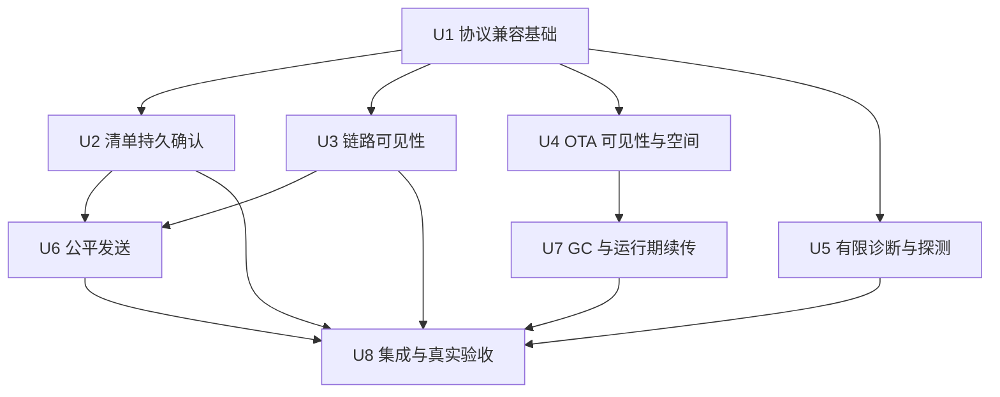

<!--
[INPUT]: Uplink 固定源码评估与 Artifactory 0.2.3 实现。
[OUTPUT]: 定义演进决策、实施依赖和验收出口。
[POS]: Emissary 演进主计划；细节由两份契约补充。
[PROTOCOL]: Update this header on change, then check AGENTS.md
-->
# Emissary 协议、观测与 OTA 演进路线

## 结论与使用范围

保留 Emissary 的执行围栏与信任模型。
吸收 Uplink 的命名操作、分流策略和链路观测。
先补可靠性与兼容性，再增加操作和弱网能力。

本计划只确定设计与实施路线。
产品代码、迁移、发行和部署均未执行。
实施复选框全部保持未完成。
每个单元可单独审查、验证和交付。
交付版本实施时从统一 `VERSION` 选择。
本计划不预先分配新版本号。

来源与细节：

- [固定源码评估](2026-11-25-emissary-uplink-assessment.md)。
- [协议、数据与有限操作契约](2026-11-25-emissary-protocol-data-contracts.md)。
- [OTA 与固定启动器契约](2026-11-25-emissary-ota-contracts.md)。
- 当前行为以 [协议](../protocol.md)、[遥测](../telemetry.md)、[OTA](../emissary-ota.md)、[节点选机](../node-placement.md)为准。
- 终端已实现，沿用 [终端手册](../terminals.md)。历史终端计划的待办不表示当前缺失。

## 事实、风险与取舍

基线为 `16535fdf1f7b2f10baaab36d58fb666d73903118`。
Uplink 固定为 `e94a67186d64b3a38233da1afdafc966082f4492`。
后续实施先核对代码漂移与共享工作树。

| 事实或风险 | 证据 | 决策及理由 |
|---|---|---|
| Telemetry 清单落盘即清除 pending，FIFO 能淘汰未确认清单 | `crates/emissary/src/telemetry/mod.rs`、`spool.rs` | 清单独立持久待确认；采样淘汰不得删除它 |
| JSON 严格解码，没有独立格式协商 | `crates/emissary-protocol/src/telemetry.rs`、`crates/telemetry-service/src/lib.rs` | 增量增加协商 RPC；旧 JSON 保持原字节 |
| 永久拒收当前只按 gRPC code 分类 | `crates/emissary/src/telemetry/mod.rs` | 新端使用机器可读原因；未知拒收保留并降速 |
| 资源 FIFO 补报推迟新鲜数据 | `crates/emissary/src/telemetry/spool.rs` | 在指标建立后增加有界公平发送 |
| OTA 已有签名、generation、排空、健康确认和回滚 | `crates/emissary/src/ota.rs`、`crates/control-plane/src/store/ota.rs` | 保留现有生命周期；扩展可操作性 |
| 下载和恢复由固定 launcher 执行 | `crates/emissary/src/ota.rs` 的 `supervise` 与 `download` | launcher 能力单独报告；新能力需管理员安装迁移 |
| 启动 metadata 已有独立 ACK 与调度摘要 | `crates/control-plane/src/store/node_metadata.rs` | 观测刷新不改调度快照；能力采纳另设门禁 |

清单淘汰与格式失配属于源码确认的风险路径。
本轮未复现线上丢数，也没有新增运行回归。
不实施时，当前构建围栏仍成立。
代价是长离线清单缺失和混合部署演进受限。

未选择的路线：

- MQTT 双栈：现有 mTLS/gRPC 与业务 ACK 已满足交付边界。
- 通用 Action 引擎：构建、OTA、终端的恢复规则不同。
- 放宽所有 JSON 字段：会隐藏拼写错误，仍不能表达能力支持。
- 修改旧批次时间后补报：破坏摘要幂等与真实采样语义。
- 先实现压缩和插件：缺少瓶颈数据与首个业务消费方。

## 需求追踪

| ID | 用户关注点与完成条件 | 单元 |
|---|---|---|
| R1 | 协议：格式协商独立于 Control，旧端安全降级 | U1 |
| R2 | 协议：命令目录、类型解码、明确不支持回执 | U1、U5 |
| R3 | 上报：清单保留至业务确认，重启和超窗语义明确 | U2 |
| R4 | 上报：原字节幂等、拒收分类、磁盘与时钟故障可解释 | U1–U3 |
| R5 | 上报：新鲜摘要和历史补报都有有界份额 | U6 |
| R6 | 探测：错误类别、时间、版本、预算与脱敏一致 | U5 |
| R7 | Action：有限操作有授权、截止、去重和恢复 | U5 |
| R8 | 探测：刷新不悄悄改变已固定的调度能力 | U5 |
| R9 | OTA：空间、字节进度、排空与停滞原因可见 | U4 |
| R10 | OTA：安全 GC、严格续传和过期 URL 刷新 | U7 |
| R11 | 交付：新旧混合矩阵、launcher 迁移和六平台证据分层 | U8 |
| R12 | 扩展：本地接入、日志源和批次升级有明确准入门槛 | 延后能力 |

## 不变量

1. 构建保持 assign/accept/start grant、attempt/lease 和进程树回收。
2. 构建日志保持独立额度与失败闭锁，不能按采样淘汰。
3. 数据 ACK 必须晚于事务提交；本地删除必须匹配记录身份。
4. 旧离线记录不重新编码，不更换 ID、时间或摘要。
5. 身份来自 mTLS；外部数据不能指定租户、节点或 attempt。
6. 普通心跳只读缓存；探测、上传与下载不阻塞租约。
7. 节点版本不同、发行导入和重新连接均不授权 OTA。
8. 固定 launcher、运行程序与 OS/SDK 的更新边界分开。
9. 数据和状态都有硬上限；越界必须有可见原因。
10. 历史观测不自动取得执行或调度权限。

## 顺序与交付门禁

| 批次 | 出口 | 进入下一批的条件 |
|---|---|---|
| A：U1–U3 | 格式兼容、清单可靠性、链路指标 | 旧 fixture、混合服务、填满与断电边界通过 |
| B：U4 | OTA 可解释且空间不足安全失败 | 新旧 launcher 均有明确能力与迁移证据 |
| C：U5 | 有限诊断与观测刷新 | 权限、去重、重启、取消及结果预算通过 |
| D：U6、U7 | 积压公平发送与弱网下载 | 基于 A/B 指标；不更改已承诺的恢复政策 |
| E：U8 | 组合运行与分层验收 | 每项证据能追溯源码、配置、环境与结果 |

批次可独立发布，不等待延后能力。
U4 的展示与 U2 可以并行开发，但都先落 U1 契约。
此处描述依赖，不授权并行代理或正式环境变更。

## 实施单元

新增路径为目标路径，实施时按现有模块地图调整。
迁移序号实施时重新读取，不预占编号。
超出 800 行的模块先按现有职责拆分。

### U1：协议演进与命令目录

- [ ] 覆盖 R1、R2、R4。先固定旧行为，再扩展接收端。
- 修改 `proto/artifactory/emissary/v1/emissary.proto`、`crates/emissary-protocol/src/{lib.rs,telemetry.rs}`、`crates/telemetry-service/src/lib.rs`、`crates/emissary/src/{runner.rs,telemetry/mod.rs}`、`crates/control-plane/src/{grpc.rs,dispatch.rs}`。
- 新增共享 `crates/emissary-protocol/src/commands.rs` 与 `telemetry_negotiation.rs`，仅定义现有命令和本计划新增命令；不建设动态插件注册器。
- 用新增 RPC 协商；未实现时仅发送精确 legacy v1。Control 的能力不代替 Telemetry 协商。业务契约见配套文档。
- 接收端按格式分派；未支持格式在写库前拒绝。新发送端不得把 schema 不匹配当普通坏数据删除。
- 测试路径：`crates/emissary-protocol/tests/wire_compatibility.rs`、新增 `tests/telemetry_negotiation.rs`；`crates/emissary/tests/live_protocol.rs`、新增 `tests/telemetry_protocol.rs`；`crates/telemetry-service/tests/database.rs`。
- 场景：旧 JSON/字段号固定；旧新端三方组合；协商超时、Unimplemented、无交集；同负载均衡连接后端变化；显式不支持和空 payload；新端重启重放旧字节；不因未知 schema 删除数据。
- 出口：接收端先部署时旧设备无行为变化；新设备遇旧服务仍能报 v1。

### U2：清单独立持久确认

- [ ] 覆盖 R3、R4。依赖 U1；首先补可失败的淘汰回归。
- 修改 `crates/emissary/src/telemetry/{mod.rs,spool.rs}`；新增 `inventory_delivery.rs`，复用 `config.rs` 私有原子文件与单写者锁。
- 扩展 `crates/emissary-protocol/src/telemetry.rs` 与 Telemetry RPC；修改 `crates/telemetry-service/src/{lib.rs,store/ingest.rs,store/history.rs,store/models.rs,store/purge.rs}`。
- 追加 `crates/telemetry-service/migrations/history.toml`、下一条 `migrations/migrations/*.sql` 和 snapshot；清单回执、按 startup/revision 的观察索引使用增量表。
- 修改 `deploy/telemetry-business-readonly.sql` 与 `crates/telemetry-service/src/store/{connect.rs,mod.rs}`，补只读startup归属查询；查询接口调用方携带当前startup，不能直接取全节点时间最大值。
- 分别保护当前启动清单与最新待确认刷新；从可解码旧 `.batch` 提取待确认清单后才允许淘汰。已在旧版本丢失的记录不能凭空恢复。
- 测试路径：`crates/emissary/src/telemetry/spool.rs` 单元测试、新增 `crates/emissary/tests/inventory_delivery.rs`；`crates/telemetry-service/tests/database.rs` 与 `workspace_lifecycle.rs`。
- 场景：长离线填满、多个重启、ACK 丢失、事务回滚、同 ID 异摘要、写盘失败、损坏记录、超48h、时钟错、退休 startup、节点删除与补交竞态、旧服务等待兼容端、保护额度耗尽。
- 出口：普通采样填满不删除当前待确认清单；历史清单不能覆盖当前 startup 的视图。

### U3：链路自观测与控制台解释

- [ ] 覆盖 R4。依赖 U1；指标先于流量策略调整。
- 修改 `crates/emissary/src/telemetry/{mod.rs,spool.rs,collector.rs}`、`crates/emissary-protocol/src/nodes.rs` 的有界诊断投影、`crates/telemetry-service/src/lib.rs`、`crates/control-plane/src/store/node_queries.rs`。
- Web 使用现有节点详情运维区；新增 `web/src/components/node-telemetry-status.tsx`，修改 `web/src/lib/types.ts` 和 `web/src/messages/{zh-CN,en}.json`。不扩大列表全量 payload。
- 诊断包含队列字节/条数/最老年龄、最后 ACK、当前退避、有限拒收原因及 collector 耗时/错误；每节点投影上限 4 KiB，纳入完整心跳总预算。
- Prometheus 使用固定 reason/collector 枚举；节点、路径、operation ID 和错误文本不能成为标签。
- 测试路径：`crates/emissary/tests/contracts.rs`、`crates/emissary-protocol/tests/nodes.rs`、新增 `crates/telemetry-service/tests/ingest_metrics.rs`、`web/tests/ui/node-details.spec.ts`。
- 场景：无数据、旧节点缺字段、断网、限流、磁盘满、未来时钟、schema 等待、永久坏记录、权限撤销、重启计数、指标基数与心跳超限。
- 出口：用户能区分“离线积压”“无权限”“格式不支持”“采集不可用”；未知值不显示为零。

### U4：OTA 空间、进度和固定 launcher 迁移

- [ ] 覆盖 R9、R11。依赖 U1；不依赖 U5 的有限操作执行器。
- 修改 `crates/emissary/src/ota.rs`，按下载/空间/状态职责拆入 `crates/emissary/src/ota/`；修改 `runner.rs`、`service.rs`、`crates/control-plane/src/{ota.rs,store/ota.rs,store/ota_management.rs}`。
- 同步 `crates/control-plane/src/installation/` 的平台安装器和 `scripts/` 内实际发行/服务验收入口；不能通过运行程序 OTA 冒充 launcher 迁移。
- Web 沿用节点运维区与当前升级确认；新增 `web/src/components/emissary-update-progress.tsx`，只展示真实支持字段。
- 空间公式、有限进度频率、drain 详情、旧 launcher 降级、安装迁移与回退见 OTA 契约。
- 测试路径：`crates/emissary/tests/{ota_download.rs,live_protocol.rs,native_service.rs}`、`crates/control-plane/tests/database/{ota_manual.rs,ota_versions.rs}`、`web/tests/ui/{emissary-ota.spec.ts,emissary-manual-update.spec.ts}`。
- 场景：低空间、检查后被占满、不同挂载点、只读盘、旧 launcher、进度缺失/停滞、构建/日志/终端排空、取消竞态、迁移中断、服务配置与身份读回。
- 出口：低空间保留旧版本；新字段缺失不显示伪进度；迁移前后 UUID、证书、队列和服务账户一致。

### U5：有限诊断、探测结果和清单观察刷新

- [ ] 覆盖 R2、R6–R8。依赖 U1、U2；复用 U3 展示与预算。
- 首批只实现 `collect_diagnostics` 和 `refresh_inventory`。`flush_telemetry` 延后；普通上传循环已经持续排空。
- 新增 `crates/emissary-protocol/src/operations.rs`、`crates/emissary/src/operations/{mod.rs,journal.rs,diagnostics.rs}`；修改 `doctor.rs`、`runner.rs`、`telemetry/inventory.rs`。
- Control 新增 `crates/control-plane/src/api/node_operations.rs`、`store/node_operations.rs`；接入现有认证、节点锁、持久命令、审计和生命周期删除，追加 Business 增量迁移。
- 新增 `web/src/components/node-operations.tsx`，接入节点详情运维区。操作结果不进入构建日志和一般通知正文。
- 探测类型、截止、结果预算、取消和跨重启规则见数据契约。刷新仅新增观察 revision，调度仍使用启动 metadata。
- 测试路径：新增 `crates/emissary-protocol/tests/operations.rs`、`crates/emissary/tests/node_operations.rs`、`crates/control-plane/tests/database/node_operations.rs`、`web/tests/ui/node-operations.spec.ts`；扩展 `crates/emissary/tests/process_tree.rs`。
- 场景：跨租户与角色、Token/CSRF、撤权、重复 ID 相同/异摘要、未确认接受、断网重连、启动变化、取消与完成竞争、过期/时钟、输出过大/脱敏、unsupported/timeout/permission_denied、结果删除。
- 出口：重复消息不重复探测；重启报告 interrupted；刷新不改变已有计划或节点 metadata_digest。

### U6：新鲜数据与历史补报公平发送

- [ ] 覆盖 R5。依赖 U2、U3；格式仍沿用 U1 已支持版本。
- 修改 `crates/emissary/src/telemetry/{collector.rs,spool.rs,mod.rs}`；新增 `scheduler.rs`；调整接收端按 startup 的最新资源投影。
- 采用受保护清单、可替换的待发最新主机槽、不可变历史采样三类；发送中主机记录另行固定，不能被同 ID 替换。
- 历史持续积压时，每完成一个最新主机批次后，至少给一个历史批次发送机会；历史不存在时不空等。清单首试优先，失败使用独立退避，不能阻塞其他类别。
- 历史批次拆分仅作用于新采样。旧混合 `.batch` 保持整体原字节。未入发送队列的主机快照替换计 `coalesced`，与已落盘记录淘汰分开。
- 额度固定为4MiB清单、1MiB最新主机、27MiB历史。主机单份最多512KiB，发送中与待发合计不超过1MiB；旧1MiB批次仍作为历史接收。
- 在主机每30秒采样、RPC端到端最多20秒、网络稳定且无失败/限流时，未被coalesced的最新快照从采集到ACK的测试目标为60秒内。验收持续读取服务端当前startup，确认最新快照年龄始终小于90秒；不要求已合并快照各自取得ACK，也不对断网作时延保证。
- 测试路径：新增 `crates/emissary/tests/telemetry_fairness.rs`，扩展 `spool.rs` 单测与 `crates/telemetry-service/tests/database.rs`。
- 场景：历史填满、最新连续生成、清单持续失败、最大1MiB旧批次、错序 ACK、暂停格式队列、断点重启、内存/磁盘上限、旧 startup 最新数据不得影响当前资源。
- 出口：可用链路中最新数据和历史都持续前进；新鲜性仍同时校验 sampled_at/received_at。

### U7：受保护资产 GC 与严格运行期续传

- [ ] 覆盖 R10。依赖 U4；先 GC 与故障矩阵，再启用续传。
- 新增 `crates/emissary/src/ota/{storage.rs,download.rs}`，扩展固定 launcher 能力与本地状态版本；Control 增加只领取原冻结资产 URL 的授权接口。
- 接口修改 `proto/artifactory/emissary/v1/emissary.proto` 与 `crates/control-plane/src/{grpc.rs,ota.rs,store/ota.rs}`；runtime通过私有邮箱转交请求，不把登录Token交给launcher。
- 不增加跨进程自动续传；进程中断仍终态失败，管理员显式重试产生新 update ID/generation。
- 续传只在一次已授权执行的 300秒下载窗口内发生；预算耗尽失败，不能重置时间无限重试。
- 测试路径：扩展 `crates/emissary/tests/ota_download.rs`，新增 `tests/ota_storage.rs`；扩展 `crates/control-plane/tests/database/ota_manual.rs`。
- 场景：HTTP 200/206/416、错 Content-Range、Content-Encoding、对象变化、分块断流、URL 过期刷新、取消迟到响应、GC/激活竞态、符号链接/Windows reparse point、持有句柄、删除后崩溃恢复。
- 出口：最终全文件摘要与大小匹配才激活；current/previous/candidate/活动下载从不被 GC 删除。

### U8：混合部署、回退与真实验收

- [ ] 覆盖 R11，复核 R1–R10。按每批出口逐次执行，不等所有单元结束才发现兼容问题。
- 更新 `docs/{protocol.md,telemetry.md,node-placement.md,emissary-ota.md,api.md,operations.md}` 及实际受影响模块的 L3/L2；实施新增顶层边界时更新根 `AGENTS.md`。
- 在 `docs/acceptance/emissary/` 新建带日期证据，更新该目录地图；本计划状态不能替代验收记录。
- 验证代码路径：`tests/` 中新增故障场景驱动，复用现有 `crates/emissary/tests/support/live_protocol.rs`；六平台使用 `.github/workflows/emissary-release.yml` 的原生服务门禁。
- 测试组合：旧设备/新服务、新设备/旧服务、独立新旧 Control/Telemetry、多副本混部、离线旧 spool、旧/新 launcher 与回退运行程序。
- 实机优先 Linux arm64、macOS arm64、Windows x64。其余平台保留 CI/原生服务/真实硬件分别记录，不以交叉编译替代。
- 每次交付记录源码、不可变镜像/二进制摘要、迁移、身份、队列、心跳、构建、终端、遥测与 OTA 结果。
- 出口：有可执行回退步骤和实际读回；未覆盖的物理环境明确列出。

## 发布与恢复

接收端先于新发送行为发布。
先增加表和双读，再启用新写。
新 schema 首轮默认关闭，只启用兼容协商。
确认所有接收副本支持后，才提高发送格式上限。
新字段始终由对应能力门禁控制。

回退先关闭新操作准入和新格式生成。
保留已接受操作的终态协调与新格式接收。
新记录排空前不能撤掉唯一兼容接收端。
旧程序不能读取的新 spool 目录由新发送器保留，不交给旧清扫器。
数据库使用追加迁移；回退代码不删除新表或回执。
launcher 回退先确认旧端能读当前状态，必要时导出兼容状态。
任何回退均保留证书、UUID、未确认日志和受保护清单。

## 延后能力及重新评估条件

| 能力 | 进入设计的条件 | 现在的决定 |
|---|---|---|
| 压缩与更大批量 | U3 测得带宽瓶颈，给出收益/CPU/延迟基线 | 保持 identity、1MiB；未来摘要绑定解压原字节且限制解压预算 |
| 外部应用 IPC | 至少一个明确来源、字段与消费方 | Unix socket/Windows named pipe、ACL、allowlist、schema、限速；身份由 Emissary 注入 |
| journald/logcat 等日志源 | 明确服务、保留期限和脱敏规则 | 默认关闭，不采集完整环境/命令行/全机日志 |
| 调度采用刷新清单 | 明确需要不中断进程更新调度能力 | 单独设计 metadata revision 与旧计划失效；当前刷新只观测 |
| flush_telemetry | 上传策略存在实际运维阻碍 | 只唤醒发送器，不绕额度/退避/权限；未列入首批 |
| 金丝雀/维护窗口 | 管理员需要跨节点一次授权的升级活动 | 独立 campaign 合同；不改为版本差异自动升级 |
| 跨进程下载 checkpoint | 运行期续传后仍有显著浪费 | 先确定持久任务和管理员重试语义，不从 `.part` 自动启动 |
| SDK/OS/launcher 自更新 | 独立签名、权限、健康与回退需求获确认 | 当前 OTA 仅更新 Emissary runtime |

## 计划完成门槛

设计完成与产品完成分开记录。
设计需满足：需求有落点，关键接口有定义，故障有去向。
每个单元需有具体文件、场景、依赖和验收出口。
材料不能把推断风险写成已复现事故。
审查发现和修订结果附在下方。

### 审查记录

2026-11-25完成两轮串行审查，范围含本计划及两份契约。
按仓库要求由主线程执行，未声称独立代理审计。

| 视角 | 发现与处理 | 复查结果 |
|---|---|---|
| 一致性 | 新ProbeReport若加入旧Inventory会触发严格拒收；改放operations schema；清单保留原v1内容 | 两种schema独立，旧fixture不变 |
| 可实施性 | 只更新runtime不能改变下载器；明确固定launcher安装迁移；U4不依赖尚未实现的GC | U4可独立交付，U7才启用GC/Range |
| 可实施性 | 清单归属与当前startup查询缺少数据依赖；补node_startups只读授权和新查询键 | 不需跨库写事务，不放宽授权角色 |
| 安全 | 新清单RPC与结果缺少完整预算；补认证、节点归属、限流、tombstone、保留和删除 | 新入口均有权限与资源边界 |
| 安全 | URL过期刷新可能改变目标；固定update/generation/manifest/asset且只走mTLS | 刷新只改变票据，不改变执行目标 |
| 范围 | flush与通用操作框架重复现有循环；首批收敛为两个有限操作 | 不依赖插件、Shell或DAG |
| 产品 | 刷新是否即时影响选机不明确；明确首批仅观察，调度仍读启动快照 | 已固定计划不被静默改写 |
| 界面 | 未知进度、部分结果和回执丢失缺少状态；补unsupported、pending、expired、outcome_unknown | 不显示假0、假成功或假取消 |
| 反向 | 有界额度无法保证无限重启历史；明确superseded；保护当前revision 0和最新刷新 | 当前可靠性与历史上限分别承诺 |
| 反向 | 公平发送的inflight记录可能被采样器替换；改为固定身份ACK，分开待发与发送中槽 | 原字节与摘要不因排队变化 |
| 反向 | 32MiB额度与新鲜槽有重复计算；固定4/1/27MiB分配和临时峰值 | 逻辑额度、物理开销分别可观测 |
| 反向 | 断线时不能凭超时推断操作终态；增加awaiting_result与outcome_unknown | 截止不等于成功或已取消 |

复核覆盖R1–R12、每单元文件/场景/出口和兼容回退。
当前范围没有待用户决定的阻塞产品问题。
延后能力的准入条件不计为首批阻塞。
实施仍需故障注入、真实数据库与平台验收。
预算和延迟数字是初始设计值，不是已测生产SLA。
实施测量若推翻预算或顺序，先更新契约并重新审查。

文档检查：mdBook完整构建与全站链接检查通过。
新材料均有L3契约，已加入L2与导航；根地图已检查。
产品实施、提交、推送和部署均未开始。
