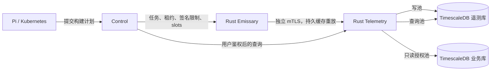

<!--
[INPUT]: 设备 mTLS、统一网关与独立 TimescaleDB 遥测服务。
[OUTPUT]: 定义采集、持久重放、访问权限和双端口私有入口。
[POS]: 设备观测协议与遥测服务的部署契约。
[PROTOCOL]: Update this header on change, then check AGENTS.md
-->
# Emissary 时序观测

所有后端使用 TimescaleDB 2.32+。默认镜像为 `timescale/timescaledb:2.32.0-pg17`，数据库访问统一由 store 层通过 Toasty 0.11 执行；连接恢复补丁及来源记录位于 `vendor/toasty/PATCH.md`。Control 和规划协调器的状态表保持普通关系表；遥测使用独立逻辑数据库、写池、查询池和 Rust 服务。

共享遥测模型归属 `artifactory_emissary_protocol::telemetry`，启动身份与选机契约归属同包的 `nodes` 模块。`artifactory.emissary.v1` RPC、JSON 字段、序列化字节和元数据摘要保持不变。模型合并不改变遥测缓存、数据库或独立服务的部署身份。



独立清单的规范身份冲突按ID与摘要持久隔离。
设备保留原字节和启动检查点，继续发送有效刷新。
隔离不构成ACK，也不计为等待格式兼容。
心跳分别上报活动隔离数、累计次数和最近冲突时间。
控制台在后续发送恢复后仍展示这些诊断。
索引与源都遵守有界额度，细节见[数据契约](plans/2026-11-25-emissary-protocol-data-contracts.md#13-拒收与重试)。

## 采集范围

| 数据 | 采集与语义 |
|---|---|
| 主机资源 | 每 30 秒采集 CPU、内存、可用内存、构建目录可用磁盘、swap、Unix load、文件系统容量、网络累计计数；平台支持时记录累计磁盘 I/O。可用内存考虑 Linux cgroup 及祖先限制 |
| 托管构建进程 | 每 10 秒采集 Emissary worker 及其后代的 CPU、RSS、I/O、状态、attempt、当前 step；PID 与启动时间共同标识进程 |
| 硬件与环境 | 每次 Emissary 进程启动采集一次 OS、内核、架构、系统启动时间、CPU 型号与核数、物理内存；可读取时记录容器、虚拟化与 Linux cgroup 有效配额 |
| 工具链与构建能力 | 进程启动时执行一次有超时和输出上限的版本探测；普通重连复用快照，更新工具后需重启 Emissary；只存签名配置的引用名称 |
| 加速器 | NVIDIA 使用有超时的 `nvidia-smi` 读取型号、驱动、VRAM、利用率；macOS 使用 `system_profiler`，Windows 使用 CIM 读取可用的显示设备身份。Apple 统一内存不作为独立 VRAM |
| 缺失与中断 | 不支持或无法读取的可选指标为 `null`，collector 状态说明采集范围；缓存淘汰、永久拒收计入累计 dropped counter；进程截断使构建汇总 `complete=false` |

不上传主机完整进程清单、进程命令行、环境变量值、工作目录或可执行文件路径。进程枚举仅在设备本地用于确认后代关系，资源计数只刷新托管进程和 Emissary 自身。硬件清单不产生 TFLOPS 或构建性能分数；工具版本探测不等同原生 SDK、签名或实际构建验收。未覆盖的 NPU、非 NVIDIA GPU 利用率保持未知。

主机 CPU 为 0–100%；进程和构建 CPU 以单个逻辑核为 100%，多核可超过 100%。磁盘、网络和进程 I/O 是累计字节计数，计算速率时应处理重启、接口变化和计数回退。RSS 汇总会重复计算共享页，不能视作主机物理内存用量。离散采样可能错过不足 10 秒的短进程。

## 数据与保留策略

| 表/视图 | 粒度 | 保留 |
|---|---|---|
| `host_samples` | 主机原始采样 | 7 天 |
| `process_samples` | PID/启动时间/attempt 原始采样 | 3 天 |
| `build_samples` | 每次采样按 attempt 汇总；缺失指标不作为零相加 | 3 天 |
| `host_minutes`, `build_minutes` | 分钟，保留有效样本数、sum、max | 30 天 |
| `host_hours`, `build_hours` | 从分钟数据按有效样本数加权 | 180 天 |

原始数据一天后进入 Hypercore 列存。保留策略按完整 chunk 删除，实际占用会包含尚未整块过期的数据。主机分钟刷新窗口为 6 天，构建为 60 小时；小时刷新窗口为 29 天。它们均短于上游保留期，避免原始数据删除后刷新把历史聚合清空。实时聚合允许读取最近尚未物化的数据，缺口不填零。

分钟 / 小时聚合覆盖主机 CPU、内存、活动 attempt，以及构建 CPU、RSS、进程数和完整性。磁盘、网络、加速器、swap、load 及逐进程 I/O 当前保留原始采样，不生成跨重启或跨设备的累计计数平均值。

静态清单正文存于 `inventory_versions`，按节点和内容摘要去重。新版 Emissary 在启动时持久化独立观察，`inventory_deliveries` 保存观察 ID、startup、revision 和交付摘要；`startup_inventories` 保存每个 startup 的最新观察。历史按接收时间保留180天，当前 startup 的最后观察另行保护。旧 batch 清单继续写入 legacy 观察；升级发送器先从原字节提取独立回填记录，再清扫采样。`latest_hosts` 与 `latest_inventories` 提供常数规模的节点摘要，乱序重放不能覆盖更新的采样。fresh 要求采样时间和接收时间都在 90 秒内，且采样时间不超过服务器 30 秒；重放旧数据不会使设备显示为新鲜。

独立清单的两类引用通过复合外键保护正文。
清扫或节点删除须先移除引用，再删除正文。
旧副本的清扫和删除遇到新引用会失败并回滚。
这只保护数据完整性，不提供旧副本功能兼容。
约束迁移完整验证既有引用；孤立回执使迁移失败。
不得删回执或伪造正文以绕过验证。

启用独立清单前，排空并停止全部旧Telemetry副本。
将查询、删除和写入路由全部切向当前版本。
旧副本不维护startup_hosts，也不理解当前startup查询。
原版新旧副本随机混部不属于支持的发布方式。
本轮按2026-11-26决定停旧后统一升级全部测试设备。
不建设兼容桥接，不承诺旧功能回退或长期新旧混部。

AI 查询和分配另以 `startup_resources` 保存每个节点／启动的最新资源摘要，批量读取当前业务节点的 `startup_id`，避免重放旧启动的数据影响当前选机。详见 [节点元数据、MCP 与 AI 选机](node-placement.md)。

## 传输、故障与权限

注册回复包含 `telemetry_endpoint`，使用设备现有的 pinned CA 和 mTLS 身份，连接独立端口 8444。主 Helm Chart 通过统一 Gateway 的 `<prefix>-gateway:8444` 透传到私有 `<prefix>-telemetry:8444`，TLS 在 Telemetry 终止。公开网关的 HTTP、控制和遥测共用一个 Service；该端口与设备控制 8443、内部 HTTPS 8445 使用独立监听和连接预算。外部设备使用可达域名或直接选择该 Service 的持久隧道；配置地址须匹配后端证书 SAN。Telemetry 每次验证证书指纹、过期和撤销；只读查询业务库确认 process attempt 属于该设备，允许已完成/已取消任务离线补报，不取得任何构建执行权。

私有 `<prefix>-telemetry` Service 同时提供查询 8093 和写入 8444，不再创建 telemetry-grpc Service。查询仍要求内部 token 与 TLS；写入仍要求设备 mTLS。该 Service 固定为 ClusterIP，设备入口通过 `gateway.service` 发布。Service 端口合并不改变两种协议或认证方式。

批次有 UUID、进程内 session、单调计时、UTC 采样时间；新版 Emissary 的 `session_id` 与 metadata 的 `startup_id` 相同。服务器在事务提交后 ACK；节点与批次 ID 构成幂等键，内容不一致的重复 ID 被拒绝。新发送器独立向 Telemetry 协商，不使用 Control 能力代替。旧服务返回Unimplemented时继续发送精确legacy v1。协商临时Unavailable、限流或20秒超时，沿用上次安全格式或启动v1并重试；权限拒收不降级。采用过摘要确认后，重连与后端切换不能降为仅ID确认。新接收端返回原字节 SHA-256；发送器匹配 ID 和摘要并完成本地持久确认后才删除记录。旧离线字节、ID和时间不改写。采样重放窗口为48小时；超窗记录按明确原因记缺口。未来时钟、权限、未知拒收和格式失配保留并退避。独立清单不套48小时窗口；其观察 ID和交付摘要须单独确认。legacy batch ACK不代替独立观察 ACK。

独立缓存位于 `<root>/telemetry/`，默认正文额度32MiB：4MiB清单、1MiB新鲜主机槽、27MiB历史采样。清单最多16条；当前启动revision0与最新未确认刷新受保护。新鲜槽分为可替换pending和固定ID的inflight，各最多512KiB。新采样按UTF8字节和实际JSON长度裁剪设备数组，持久记录omitted_host_devices与truncated_host_fields；旧磁盘原字节不裁剪。普通主机与历史合计最多8192条。每完成一个新鲜主机批次，至少给历史一次机会；独立清单使用单独任务与退避。接收端协商额度不兼容时保留原记录，并继续发送兼容记录。历史超额按最老记录淘汰；清单superseded单独记录ID、原因和累计数量。目录同步失败保留同步债务，内存索引跟随已完成的rename/unlink，避免队列卡死。损坏旧批次保留原位并跳过，新鲜槽移入opaque目录并显示数量。损坏独立清单或启动检查点只关闭清单通道；普通资源采样继续。未能提取清单的旧混合批次保持原位，禁止发送确认与额度淘汰。清单条数和字节保持未知，诊断为storage_unavailable。管理员修复存储后需重启读取，程序不猜测身份或覆盖损坏字节。刷新revision检查点损坏只使刷新操作失败，已有观察仍可发送。以上记录不自动当作成功。原子文件、索引及异常原字节的物理开销不包含在正文额度内。自定义额度至少8MiB，过小只停遥测并显示配置错误。主机重启后从相同 managed root 重放。构建日志配额独立。遥测超时、断联、数据库背压、磁盘写入失败均不返回构建错误；最后一种情况会记录本地告警，无法落盘的样本不保证补报。容器化 Emissary 应将 managed root 放在持久卷上。

服务器批次上限 1 MiB，单批最多 2048 个托管进程。读写和授权池分别限连接数，查询有超时、时间范围、6000 行与 2 MiB 响应预算。历史 API 返回 `{"samples":[],"truncated":false}`；`truncated=true` 时缩小时间区间。清单历史最多返回最近100次观察。节点最新查询携带Control当前startup；legacy数据标记来源且不取得当前startup归属。历史列表保留各startup，不用于调度。

Control 对节点查询要求 viewer 会话，对 attempt 查询要求所属项目的 read 权限。内部查询使用独立 bearer token 和 TLS，Emissary 无该 token。生产授权连接使用独立登录角色，所需权限为业务数据库的 `CONNECT`、业务 schema 的 `USAGE`，以及 `nodes`、`attempts`、`node_startups`、`__toasty_migrations` 的 `SELECT`。其中迁移表用于启动时校验 Business 版本；缺少权限会使启动失败。服务连接本身也设置只读模式。查询池可通过 `ARTIFACTORY_TELEMETRY_READ_DATABASE_URL` 指向专门的只读连接。

先由管理员创建授权登录角色并配置凭据，在 Control 初始化当前业务基线 `2026112101` 后，以该业务库的所有者执行最小授权脚本。Telemetry 直接使用 Control 的迁移清单校验业务库，缺少迁移、旧迁移身份或未知版本都会阻止启动；不提供旧版本回退：

```sh
psql "$ARTIFACTORY_BUSINESS_ADMIN_DATABASE_URL" -X -v ON_ERROR_STOP=1 \
  -v business_database=artifactory -v business_schema=public \
  -v telemetry_business_role=telemetry_authorizer \
  -f deploy/telemetry-business-readonly.sql
```

将数据库名、schema 与角色名替换为实际值，并将 `ARTIFACTORY_BUSINESS_DATABASE_URL` 配置为该角色的连接。脚本可重复执行，只授予上述对象的读取权限；授权角色不需要拥有业务表、写权限或迁移权限。自定义 schema 时，连接的 `search_path` 必须与授权 schema 一致。

遥测用于趋势、能力筛选与负载参考。启用新版 AI 选机后，控制平面还会在分配前检查当前启动的资源快照及 AI 设定的门槛；现有权限、设备签名限制、capability 和 slots 继续生效。不自动抢占、预留资源或调整并发。

## 交付诊断与有限刷新

普通心跳读取缓存，最多4KiB交付诊断。控制台显示历史、新鲜槽和清单的数量、字节、最老年龄、最后持久ACK、退避、上传延迟、采集耗时及有限错误原因。缺字段显示未知。quota eviction、expired、malformed、coalesced、清单superseded和损坏记录分开计数。Fresh、历史和清单分别记录最后ACK、最后进展、退避、延迟与有限状态。最近永久拒收原因、时间和分类计数持久保留；当前链路ready不抹除缺口解释，丢弃不伪造ACK。后台最多每10秒扫描目录元数据，缓存文件正文、临时、索引、损坏、未分类和Unix分配块占用。扫描最多16384项、8层；失败、链接或越界时总量未知。Windows分配块未知。该观测不是原子文件系统快照，Unix块数不表示CoW或压缩后的可回收空间。心跳不读取磁盘。服务Prometheus标签使用固定reason，不包含节点ID、路径或错误文本。accepted/replayed聚合采样与清单；rejected含三个RPC失败；成功协商不计持久接收。三个RPC共用64个准入许可。

永久拒收和额度淘汰将缺口计数与待删除身份原子提交。
待删除身份固定相对路径、原ID与原字节SHA256。
重试和重启先完成相同删除，不重复累计缺口。
正文变化或来源受保护时，保留来源并报告错误。
最近拒收身份最多64条、64KiB，不承担长期去重。
旧版本已发生的分离写入计数不能逆向校正。

清单本地存储故障优先于等待接收端升级。
队列不可读时，等待数、条数和字节保持未知。
Fresh同样只在明确缺失时报告零。
目录同步恢复后，健康空队列恢复ready。
本地恢复不更新ACK或最后进展时间。

租户owner/admin使用原登录Session发起`collect_diagnostics`或`refresh_inventory`。刷新新增独立清单revision，不修改启动metadata、capabilities或已固定计划。结果有授权、截止、去重、取消、重启与摘要确认边界，见[运维](operations.md)与[协议](protocol.md)。

## 部署与本地开发

TimescaleDB 扩展由数据库管理员在创建每个数据库后安装，服务器需预加载 TimescaleDB。应用启动检查扩展版本并执行 `time_bucket` 功能检查，无需读取管理员专属配置。Telemetry 应用角色拥有遥测库及自身表，不需要 superuser。

```sql
CREATE DATABASE telemetry OWNER telemetry_role;
\connect telemetry
CREATE EXTENSION timescaledb;
```

新安装的 Compose 和主 Helm Chart 自动初始化独立遥测数据库和角色。`scripts/init-deploy.sh` / `scripts/init-helm.py` 生成独立数据库口令、服务 token 和包含遥测域名的服务证书。默认镜像和数据路径仍是 PostgreSQL 17 的 Alpine 布局，UID/GID 70。开发阶段不提供已有 PostgreSQL 卷的自动转换；本地依赖使用新命名的 `artifactory-timescaledb-test`，保留既有 PostgreSQL 容器和卷。15432 被占用时启动会明确失败。

本地先运行 `sh scripts/local-services.sh`，新生成的 `.local/env` 包含遥测配置；另开终端运行 `sh scripts/run-telemetry.sh`，再按 README 启动 Control。已有私有 env 需补齐 `ARTIFACTORY_TELEMETRY_DATABASE_URL`、`ARTIFACTORY_TELEMETRY_ENDPOINT=https://localhost:8444`、`ARTIFACTORY_TELEMETRY_URL=https://localhost:8093` 和随机的 32 字符以上 `ARTIFACTORY_TELEMETRY_TOKEN`。不要把凭证提交到仓库。

服务环境变量：`DATABASE_URL` 指向遥测库；`ARTIFACTORY_BUSINESS_DATABASE_URL` 指向只读授权连接；`ARTIFACTORY_TELEMETRY_TOKEN` 用于内部查询。`ARTIFACTORY_PKI_DIR` 包含 `ca.pem/server.pem/server.key`；HTTP 查询的 TLS 另使用 `ARTIFACTORY_SERVICE_TLS_CERT/KEY`。仅挂载这些文件，服务无需 CA 私钥。默认绑定 `127.0.0.1:8444/8093`，容器中显式绑定 `0.0.0.0`。

独立 Planning Operator Chart 的 `telemetry.secretName` 需要上述数据库 URL 与 token，`telemetry.pkiSecretName` 引用设备 CA 签发的服务身份。它不会创建外部数据库。Control 另配置 `ARTIFACTORY_TELEMETRY_ENDPOINT`（设备可达）、`ARTIFACTORY_TELEMETRY_URL`（内部查询）和相同 token。服务证书 SAN 必须涵盖两种访问域名；规划 Worker 通过内部网关访问规划协调器，不直连遥测数据库。

## 查询与验证

通过 Control：

- `GET /api/v1/nodes/{id}/telemetry`：最新指标、清单、fresh。
- `GET /api/v1/nodes/{id}/inventory`：清单观察历史。
- `GET /api/v1/nodes/{id}/telemetry/history`：主机时序。
- `GET /api/v1/attempts/{id}/telemetry`：构建资源时序。
- `GET /api/v1/attempts/{id}/processes`：托管进程明细。

历史查询必须提供 ISO 8601 `from/to`，时间范围为左闭右开；`resolution=raw|minute|hour` 默认 minute。单次最大区间分别为 6 小时、2 天、31 天，且起点不得早于对应保留期。进程明细只支持 raw。

```sh
cargo test --locked --workspace
# 仅对隔离的、已启用 TimescaleDB 的管理员测试数据库执行：
cargo test --locked -p artifactory-telemetry-service --all-targets -- --ignored
python3 tests/operator/acceptance/telemetry.py --context <explicit-context> --namespace <owned-acceptance-namespace>
```

TimescaleDB 逻辑恢复应使用相同扩展版本，先安装扩展并执行 `timescaledb_pre_restore()`，串行 `pg_restore` 后执行 `timescaledb_post_restore()`；不能把遥测 dump 当作普通 PostgreSQL dump 直接并行恢复。分钟/小时物化状态、列存 chunks、后台策略和最新摘要均应纳入恢复验收。禁止将删除原始数据后的历史窗口重新全量刷新。

本次执行结果与隔离环境证据见 [2026-11-13 验收记录](acceptance/telemetry/2026-11-13.md)。
